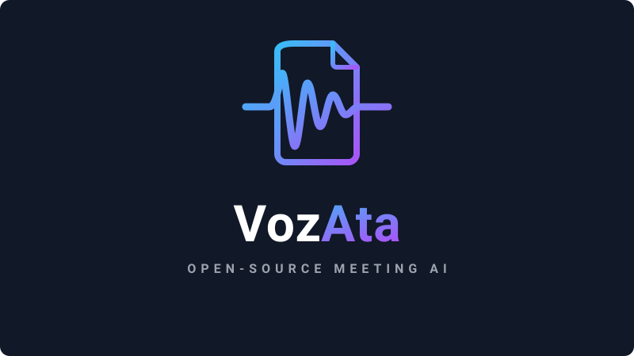
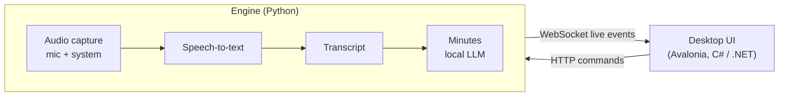

# VozAta

An open-source, privacy-first tool that captures microphone and meeting audio, transcribes
multi-speaker conversations in near real time, and uses AI to generate structured meeting
minutes (*atas*). Runs locally by default: speech-to-text on your GPU and minutes from a
local LLM.

> **Status: planning.** The roadmap and architecture are defined and no application code exists
> yet. Implementation starts with [phase 00 — Foundation](docs/roadmap/phases/00-foundation.md).

## Planned features

- Records the **microphone and system audio** (whatever the meeting app plays) at the same time
- **Near-real-time transcription** with [faster-whisper](https://github.com/SYSTRAN/faster-whisper)
  on the GPU, falling back to the CPU, with an optional external STT API
- **Meeting minutes** generated by a local LLM through [Ollama](https://ollama.com), with templates
- **Minutes so far**: minutes of what was said until now while the recording goes on, kept on
  the meeting as partial minutes apart from the final ones
- **Voice commands** while recording, from your microphone only: "VozAta, gere a ata" (minutes so
  far) or "VozAta, o que foi decidido?" (an answer about the meeting so far); phrases set on the
  Config page
- **Work on another PC**: Ollama and the speech recognition (VozAta Worker) can run on a GPU PC
  of the local network, found and paired from the Config page; this PC takes over when it is off
  ([guide](docs/remote-worker.md))
- **Desktop app** with start/stop and pause, device selection, level meters, session history,
  settings, and a tray icon
- **Speaker identification** after the session and live, with speaker renaming
- Export to Markdown, DOCX and PDF; **action items** exported to Azure DevOps or GitHub
- Crash recovery, echo dedupe, custom vocabulary, an editable transcript, cross-session search,
  and "ask the meeting" Q&A
- UI in English, Brazilian Portuguese and Spanish

## Architecture

- **`engine/`**: a Python engine that does the audio capture, speech-to-text, minutes generation,
  storage and export, and exposes a local API.
- **`ui/`**: an Avalonia desktop app that consumes that API.

See [architecture.md](docs/roadmap/architecture.md) and
[api-contract.md](docs/roadmap/api-contract.md) for the details.

## Roadmap

| Milestone | Phases | Outcome |
|-----------|--------|---------|
| M1 — CLI MVP | 00–05 | Record, live transcript in the terminal, WAV files, minutes |
| M2 — Desktop app | 06–11 | Avalonia UI: start/stop, devices, history, settings, export |
| M3 — Distribution | 12–13 | External STT option and installer |
| M4 — Intelligence | 14–24 | Speakers, recovery, echo dedupe, vocabulary, templates, editing, search, action items, Q&A |

Phase status and dependencies are tracked in [docs/roadmap/README.md](docs/roadmap/README.md).

## Requirements (target)

- Windows 11 (system audio is captured through WASAPI loopback)
- Python 3.13
- An NVIDIA GPU with CUDA is recommended (the reference machine has 6 GB of VRAM); the CPU works
  as a fallback
- [Ollama](https://ollama.com) for local minutes generation
- .NET 10 SDK for the desktop UI

## Contributing

Work follows the roadmap one phase at a time. Start at
[docs/roadmap/README.md](docs/roadmap/README.md), follow
[docs/roadmap/standards.md](docs/roadmap/standards.md), and see [CLAUDE.md](CLAUDE.md) for the
session workflow and global rules: English only, localized user-facing text, SOLID, and tests for
every change.

## Privacy

Audio, transcripts and minutes stay on your machine unless you configure an external provider.
Recordings are git-ignored. Getting consent to record is the user's responsibility.

## License

[MIT](LICENSE)
