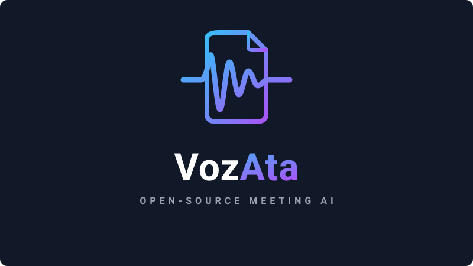
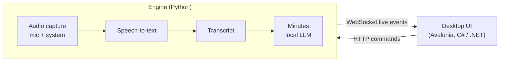

# VozAta

<p align="center"></p>

An open-source, privacy-first tool that captures microphone and meeting audio, transcribes
multi-speaker conversations in near real time, and uses AI to generate structured meeting
minutes (*atas*). Runs locally by default: speech-to-text on your GPU and minutes from a
local LLM.

> **Status: usable (v0.3.1).** Every roadmap phase is done; progress is tracked in
> [docs/roadmap/README.md](docs/roadmap/README.md). Installation: [docs/INSTALL.md](docs/INSTALL.md).

## Features

- Records the **microphone and system audio** (whatever the meeting app plays) at the same time
- **Near-real-time transcription** with [faster-whisper](https://github.com/SYSTRAN/faster-whisper)
  on the GPU, falling back to the CPU, with an optional external STT API
- **Meeting minutes** generated by a local LLM through [Ollama](https://ollama.com), with templates
- **Minutes so far**: minutes of what was said until now while the recording goes on, kept on
  the meeting as partial minutes apart from the final ones
- **Voice commands** while recording, from your microphone only: "VozAta, gere a ata" (minutes so
  far) or "VozAta, o que foi decidido?" (an answer about the meeting so far); phrases set on the
  Config page
- **Work on another PC**: Ollama and the speech recognition (VozAta Worker) can run on a GPU PC
  of the local network, found and paired from the Config page; this PC takes over when it is off
  ([guide](docs/remote-worker.md))
- **Desktop app** with start/stop and pause, device selection, level meters, session history,
  settings, and a tray icon
- **Speaker identification** after the session and live, with speaker renaming
- Export to Markdown, DOCX and PDF; **action items** exported to Azure DevOps or GitHub
- Crash recovery, echo dedupe, custom vocabulary, an editable transcript, cross-session search,
  and "ask the meeting" Q&A
- UI in English, Brazilian Portuguese and Spanish

## Architecture



- **`engine/`**: a Python engine that does the audio capture, speech-to-text, minutes generation,
  storage and export, and exposes a local API.
- **`ui/`**: an Avalonia desktop app that consumes that API.

See [architecture.md](docs/roadmap/architecture.md) and
[api-contract.md](docs/roadmap/api-contract.md) for the details.

## Roadmap

| Milestone | Phases | Outcome |
|-----------|--------|---------|
| M1 — CLI MVP | 00–05 | Record, live transcript in the terminal, WAV files, minutes |
| M2 — Desktop app | 06–11 | Avalonia UI: start/stop, devices, history, settings, export |
| M3 — Distribution | 12–13 | External STT option and installer |
| M4 — Intelligence | 14–24 | Speakers, recovery, echo dedupe, vocabulary, templates, editing, search, action items, Q&A |

Phase status and dependencies are tracked in [docs/roadmap/README.md](docs/roadmap/README.md).

## Requirements

- Windows 11 (system audio is captured through WASAPI loopback)
- Python 3.13
- An NVIDIA GPU with CUDA is recommended (the reference machine has 6 GB of VRAM); the CPU works
  as a fallback
- [Ollama](https://ollama.com) for local minutes generation
- .NET 10 SDK for the desktop UI

## Run, build and package

Commands are for PowerShell 7 (`pwsh`), from the repository root unless noted. End users only
need the installer: see [docs/INSTALL.md](docs/INSTALL.md).

### One-time setup (development)

```powershell
py -3.13 -m venv .venv
.venv\Scripts\python -m pip install -e "engine[dev,translation]"   # engine + tests
.venv\Scripts\python -m pip install -e "engine[cuda]"              # optional: NVIDIA GPU (cuBLAS, cuDNN)
```

Without the `cuda` extra (or without an NVIDIA GPU) speech recognition runs on the CPU model
(`WHISPER_CPU_MODEL`). Install [Ollama](https://ollama.com) and `ollama pull qwen2.5:7b` for the
minutes.

### Open VozAta from the command line

```powershell
cd ui
dotnet run --project src/VozAta.Desktop          # builds if needed, then opens the app
```

Run it from `ui/`: the app starts its engine (`python -m vozata serve`) and recorder
(`python -m vozata.recorder`) through `../.venv` and `../engine`, as set in
`ui/src/VozAta.Desktop/appsettings.json`. Without the window:

```powershell
cd engine
..\.venv\Scripts\python -m vozata serve         # engine API only, on http://127.0.0.1:8765
..\.venv\Scripts\python -m vozata record        # record in the terminal (Ctrl+C stops)
```

An installed copy opens with `& "$env:LOCALAPPDATA\Programs\VozAta\VozAta.Desktop.exe"`.

### Build and test

```powershell
dotnet build ui/VozAta.sln                       # desktop + worker apps
dotnet test ui/VozAta.sln
cd engine; ..\.venv\Scripts\python -m pytest     # engine tests
```

Close a running Debug app before `dotnet test` because it locks `bin\Debug`.

### Build the installers

```powershell
.venv\Scripts\python -m pip install -e "engine[translation,package]"   # PyInstaller and uv
pwsh packaging/build.ps1 -Version 1.0.0 -Python .venv\Scripts\python.exe
```

This needs the .NET 10 SDK and [Inno Setup](https://jrsoftware.org/isinfo.php) 6 or 7 (`iscc` on
`PATH`, or installed per user under `%LOCALAPPDATA%\Programs`). Without Inno Setup the script
stops after preparing `build/`. Output: `build/installer/VozAta-Setup-<v>.exe` and
`VozAta-Worker-Setup-<v>.exe`. The standard build takes about 10–12 minutes. Use `-Out <folder>`
to build outside a synced folder such as OneDrive.

**With or without CUDA.** There is a single installer: the NVIDIA CUDA libraries (and speaker
identification) are never bundled, and the build fails if `torch` or `nvidia` gets into it. CUDA
is chosen when installing:

- **With CUDA:** on a PC with an NVIDIA driver, the setup shows *Download GPU support for speech
  recognition*, ticked. It downloads about 1.2 GB into `%LOCALAPPDATA%\VozAta\cuda`.
- **Without CUDA:** untick that option, or install on a PC without an NVIDIA driver, and the
  CPU is used.
- **Later:** run `& "$env:LOCALAPPDATA\Programs\VozAta\engine\vozata-engine.exe" cuda install`
  (`cuda status` and `cuda remove` also work).

See [docs/INSTALL.md](docs/INSTALL.md#gpu-support) for details.

## Contributing

Work follows the roadmap one phase at a time. Start at
[docs/roadmap/README.md](docs/roadmap/README.md), follow
[docs/roadmap/standards.md](docs/roadmap/standards.md), and see [CLAUDE.md](CLAUDE.md) for the
session workflow and global rules: English only, localized user-facing text, SOLID, and tests for
every change.

## Privacy

Audio, transcripts and minutes stay on your machine unless you configure an external provider.
Recordings are git-ignored. Getting consent to record is the user's responsibility.

## License

[MIT](LICENSE)
