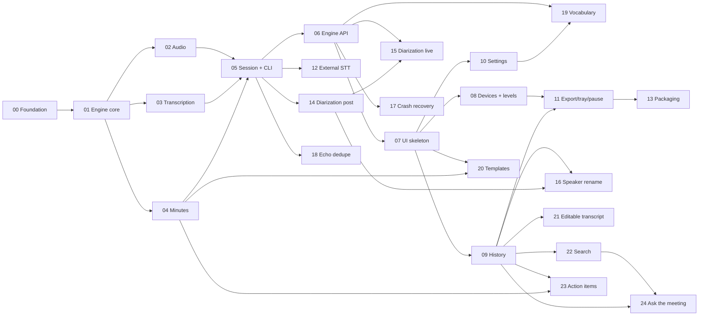

# Meeting Minutes — Roadmap

Near-real-time meeting transcription (microphone + system audio) with LLM-generated meeting
minutes. A Python **engine** (capture, speech-to-text, minutes) exposes a local HTTP + WebSocket
API consumed by an Avalonia (C#) **desktop UI**. User-facing text is localized in English (default),
Brazilian Portuguese and Spanish.

This roadmap is designed so that **each phase can be executed by a fresh session with a cleared
context**. Read only what the phase asks for.

## How to run a session

1. Read this README (you are here).
2. Pick the **first phase with status `todo` whose dependencies are all `done`** (or the phase the
   user names). Phases in the same parallel group can run in separate sessions at the same time.
3. Read **only** that phase file and the documents listed in its *Read first* section.
4. Until phase 00 is `done`, [standards.md](standards.md) replaces the project `CLAUDE.md` files.
5. Create the branch `feature/<NN-slug>` (e.g. `feature/03-transcription`).
6. Implement with TDD; respect [standards.md](standards.md).
7. Tick every acceptance criterion in the phase file, then set the phase status to `done` in the
   table below (and `in progress` while working on it).
8. If the phase changes a shared contract (config key, endpoint, event, data-model field), update
   [architecture.md](architecture.md) or [api-contract.md](api-contract.md) in the same branch.

## Shared documents

| Document | Contents |
|----------|----------|
| [architecture.md](architecture.md) | Components, ports, SOLID mapping, data flow, stitching algorithm, data model, config keys, i18n, speaker identification, VRAM ordering, environment facts |
| [api-contract.md](api-contract.md) | Engine HTTP endpoints and WebSocket events, each tagged with the phase that implements it |
| [standards.md](standards.md) | Coding standards; the exact content of the three `CLAUDE.md` files created in phase 00 |

## Status

| # | Phase | Depends on | Status |
|---|-------|------------|--------|
| 00 | [Foundation](phases/00-foundation.md) | — | todo |
| 01 | [Engine core](phases/01-engine-core.md) | 00 | todo |
| 02 | [Audio capture and files](phases/02-audio.md) | 01 | todo |
| 03 | [Transcription](phases/03-transcription.md) | 01 | todo |
| 04 | [Minutes generation](phases/04-minutes.md) | 01 | todo |
| 05 | [Session and CLI (MVP)](phases/05-session-cli.md) | 02, 03, 04 | todo |
| 06 | [Engine API](phases/06-engine-api.md) | 05 | todo |
| 07 | [UI skeleton](phases/07-ui-skeleton.md) | 06 | todo |
| 08 | [UI devices and level meters](phases/08-ui-devices-levels.md) | 07 | todo |
| 09 | [UI session history](phases/09-ui-history.md) | 07 | todo |
| 10 | [UI settings](phases/10-ui-settings.md) | 07 | todo |
| 11 | [Export, tray and pause](phases/11-export-tray-pause.md) | 08, 09 | todo |
| 12 | [External STT API](phases/12-external-stt.md) | 05 | todo |
| 13 | [Packaging](phases/13-packaging.md) | 11 | todo |
| 14 | [Speaker identification (post-session)](phases/14-diarization-post.md) | 05 | todo |
| 15 | [Speaker identification (live)](phases/15-diarization-live.md) | 14, 06 | todo |
| 16 | [UI speaker rename](phases/16-ui-speaker-rename.md) | 09, 14 | todo |
| 17 | [Crash recovery](phases/17-crash-recovery.md) | 06 | todo |
| 18 | [Echo dedupe](phases/18-echo-dedupe.md) | 05 | todo |
| 19 | [Custom vocabulary](phases/19-custom-vocabulary.md) | 06, 10 | todo |
| 20 | [Minutes templates](phases/20-minutes-templates.md) | 04, 07 | todo |
| 21 | [Editable transcript](phases/21-editable-transcript.md) | 09 | todo |
| 22 | [Cross-session search](phases/22-search.md) | 09 | todo |
| 23 | [Action items export](phases/23-action-items.md) | 04, 09 | todo |
| 24 | [Ask the meeting](phases/24-ask-the-meeting.md) | 09, 22 | todo |

**Parallel groups** (independent once their dependencies are done): 02 / 03 / 04 · 08 / 09 / 10 ·
12 / 14 / 17 / 18 · 20 / 21 / 22.

**Milestones**
- **M1 — CLI MVP** (00–05): record, live transcript in the terminal, three WAVs, minutes.
- **M2 — Desktop app** (06–11): Avalonia UI with start/stop, devices, history, settings, export.
- **M3 — Distribution** (12–13): external STT option and installer.
- **M4 — Intelligence** (14–24): speakers, recovery, echo dedupe, vocabulary, templates, editing,
  search, action items, Q&A.

## Dependency graph

## Backlog (not scheduled)

- Live rolling summary ("catch me up" during the meeting).
- Additional LLM providers (OpenAI-compatible chat, Anthropic) behind `LanguageModel`.
- Auto-detect meeting apps (Teams / Zoom / Meet audio sessions) and suggest recording.
- WER benchmark harness with reference recordings to tune `CHUNK_SECONDS` and models.

## Phase file template

Every file in `phases/` has the same sections: **Goal · Depends on · Read first · Scope ·
Design notes · Acceptance criteria · Tests · Out of scope · Kickoff prompt**. The kickoff prompt is
the message to paste into a fresh session to start the phase.
