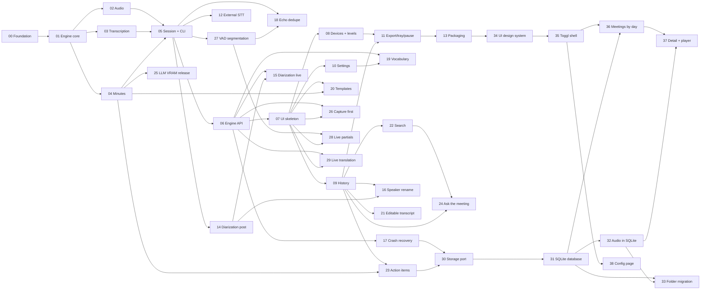

# VozAta — Roadmap

Near-real-time meeting transcription (microphone + system audio) with LLM-generated meeting
minutes. A Python **engine** (capture, speech-to-text, minutes) exposes a local HTTP + WebSocket
API consumed by an Avalonia (C#) **desktop UI**. User-facing text is localized in English (default),
Brazilian Portuguese and Spanish.

This roadmap is designed so that **each phase can be executed by a fresh session with a cleared
context**. Read only what the phase asks for.

## How to run a session

1. Read this README (you are here).
2. **Resume before starting anything new.** A session can end at any time (tokens run out, the PC
   shuts down), so the work in progress lives on its feature branch, not in `main`. Run
   `git fetch`, then look for unmerged phase branches (`git branch -a --list "*feature/*"`,
   `gh pr list`). If one exists: check it out, run `git status` for uncommitted work, read the
   phase file's **Progress** section and continue from its *Next step*. Skip steps 3–6.
3. Pick the **first phase with status `todo` whose dependencies are all `done`** (or the phase the
   user names). Phases in the same parallel group can run in separate sessions at the same time.
4. Read **only** that phase file and the documents listed in its *Read first* section.
5. Until phase 00 is `done`, [standards.md](standards.md) replaces the project `CLAUDE.md` files.
6. Create the branch `feature/<NN-slug>` (e.g. `feature/03-transcription`). Its **first commit**
   sets the phase status to in progress (`feature/NN-slug`) in the table below and appends the
   **Progress** section ([template](#progress-section-template)) to the phase file, listing the
   planned steps.
7. Implement with TDD; respect [standards.md](standards.md). One logical change per commit, and
   **every commit also updates Progress** (tick the step, set *Next step*, record decisions and
   blockers) and is pushed — the branch on GitHub always shows exactly where work stopped.
8. Tick every acceptance criterion in the phase file, then set the phase status to `done` in the
   table below and the Progress status to `ready for PR`.
9. If the phase changes a shared contract (config key, endpoint, event, data-model field), update
   [architecture.md](architecture.md) or [api-contract.md](api-contract.md) in the same branch.

## Shared documents

| Document | Contents |
|----------|----------|
| [architecture.md](architecture.md) | Components, ports, SOLID mapping, data flow, stitching algorithm, data model, config keys, i18n, speaker identification, VRAM ordering, environment facts |
| [api-contract.md](api-contract.md) | Engine HTTP endpoints and WebSocket events, each tagged with the phase that implements it |
| [standards.md](standards.md) | Coding standards; the exact content of the three `CLAUDE.md` files created in phase 00 |
| [optimizations.md](optimizations.md) | Review of `streaming-translator` and the design behind phases 25–29 and the context prompt in 19 |
| [waves.md](waves.md) | Parallel waves for the remaining phases, rules for parallel sessions, and a start/resume prompt per phase |

## Status

Status values: **todo** (not started) · **in progress** (`feature/NN-slug`) (work lives on that
branch and is **not** in `main` yet: never delete the branch) · **done** (merged into `main`).

| # | Phase | Depends on | Status |
|---|-------|------------|--------|
| 00 | [Foundation](phases/00-foundation.md) | — | done |
| 01 | [Engine core](phases/01-engine-core.md) | 00 | done |
| 02 | [Audio capture and files](phases/02-audio.md) | 01 | done |
| 03 | [Transcription](phases/03-transcription.md) | 01 | done |
| 04 | [Minutes generation](phases/04-minutes.md) | 01 | done |
| 05 | [Session and CLI (MVP)](phases/05-session-cli.md) | 02, 03, 04 | done |
| 06 | [Engine API](phases/06-engine-api.md) | 05 | done |
| 07 | [UI skeleton](phases/07-ui-skeleton.md) | 06 | done |
| 08 | [UI devices and level meters](phases/08-ui-devices-levels.md) | 07 | done |
| 09 | [UI session history](phases/09-ui-history.md) | 07 | done |
| 10 | [UI settings](phases/10-ui-settings.md) | 07 | done |
| 11 | [Export, tray and pause](phases/11-export-tray-pause.md) | 08, 09 | done |
| 12 | [External STT API](phases/12-external-stt.md) | 05 | done |
| 13 | [Packaging](phases/13-packaging.md) | 11 | done |
| 14 | [Speaker identification (post-session)](phases/14-diarization-post.md) | 05 | done |
| 15 | [Speaker identification (live)](phases/15-diarization-live.md) | 14, 06 | done |
| 16 | [UI speaker rename](phases/16-ui-speaker-rename.md) | 09, 14 | done |
| 17 | [Crash recovery](phases/17-crash-recovery.md) | 06 | done |
| 18 | [Echo dedupe](phases/18-echo-dedupe.md) | 05, 27 | done |
| 19 | [Custom vocabulary](phases/19-custom-vocabulary.md) | 06, 10 | done |
| 20 | [Minutes templates](phases/20-minutes-templates.md) | 04, 07 | done |
| 21 | [Editable transcript](phases/21-editable-transcript.md) | 09 | done |
| 22 | [Cross-session search](phases/22-search.md) | 09 | done |
| 23 | [Action items export](phases/23-action-items.md) | 04, 09 | done |
| 24 | [Ask the meeting](phases/24-ask-the-meeting.md) | 09, 22 | done |
| 25 | [LLM VRAM release](phases/25-llm-vram-release.md) | 04 | done |
| 26 | [Capture first, load later](phases/26-capture-first.md) | 06, 07 | done |
| 27 | [Pause-based segmentation (VAD)](phases/27-vad-segmentation.md) | 05 | done |
| 28 | [Live interim text](phases/28-live-partials.md) | 27, 07 | done |
| 29 | [Live translation (optional)](phases/29-live-translation.md) | 06, 07 | done |
| 30 | [Storage port](phases/30-storage-port.md) | 17, 23 | done |
| 31 | [SQLite session database](phases/31-sqlite-database.md) | 30 | todo |
| 32 | [Audio in SQLite](phases/32-audio-in-sqlite.md) | 31 | todo |
| 33 | [Folder to database migration](phases/33-folder-migration.md) | 31, 32 | todo |
| 34 | [UI design system](phases/34-ui-design-system.md) | 13 | done |
| 35 | [Toggl-style shell and timer bar](phases/35-toggl-shell.md) | 34 | done |
| 36 | [Meetings list grouped by day](phases/36-meetings-by-day.md) | 35, 31 | todo |
| 37 | [Session detail page and audio player](phases/37-detail-and-player.md) | 36, 32 | todo |
| 38 | [Config page redesign](phases/38-config-page.md) | 35 | todo |

**Parallel groups** (independent once their dependencies are done): 02 / 03 / 04 · 08 / 09 / 10 ·
12 / 14 / 17 / 18 · 20 / 21 / 22 · 25 / 26 / 27 · 28 / 29 · 30 / 34 · 31 / 35 ·
32 / 36 / 38 · 33 / 37.

**Milestones**
- **M1 — CLI MVP** (00–05): record, live transcript in the terminal, three WAVs, minutes.
- **M2 — Desktop app** (06–11): Avalonia UI with start/stop, devices, history, settings, export.
- **M3 — Distribution** (12–13): external STT option and installer.
- **M4 — Intelligence** (14–24): speakers, recovery, echo dedupe, vocabulary, templates, editing,
  search, action items, Q&A.
- **M5 — Live quality** (25–29, from [optimizations.md](optimizations.md)): GPU release after
  minutes, instant start, pause-based segmentation, live interim text, live translation.
- **M6 — Storage and UI refresh** (30–38): sessions, transcripts and audio in one SQLite database
  (`vozata.db`) with automatic migration of old folders; a Toggl Track–style desktop UI (sidebar,
  timer bar, meetings by day, in-app player) and a redesigned Config page (`.env` stays the source).

## Dependency graph



## Backlog (not scheduled)

- Live rolling summary ("catch me up" during the meeting).
- Additional LLM providers (OpenAI-compatible chat, Anthropic) behind `LanguageModel`.
- Auto-detect meeting apps (Teams / Zoom / Meet audio sessions) and suggest recording.
- WER benchmark harness with reference recordings to tune `CHUNK_SECONDS` and models.

## Phase file template

Every file in `phases/` has the same sections: **Goal · Depends on · Read first · Scope ·
Design notes · Acceptance criteria · Tests · Out of scope · Kickoff prompt**. The kickoff prompt is
the message to paste into a fresh session to start the phase. While the phase is being worked on,
it also has a **Progress** section at the end.

## Progress section template

Appended to the phase file by the first commit of the phase branch and updated by every commit
after it. It is the hand-off note for the next session, so *Next step* must be specific enough to
continue without any other context.

```markdown
## Progress

- **Branch:** `feature/NN-slug`
- **Status:** in progress | blocked | ready for PR
- **Updated:** YYYY-MM-DD HH:MM
- **Next step:** <the exact next action, e.g. "make test_stitch_overlap pass in stitching.py">

### Steps

- [x] <step> — `<short sha>`
- [ ] <step>

### Decisions and notes

- <deviations from the plan, assumptions, blockers, anything the next session must know>
```
