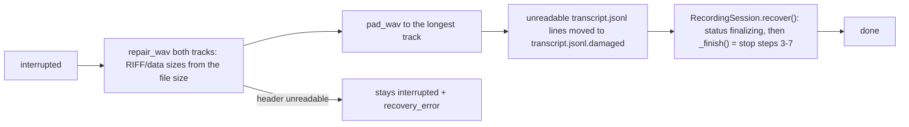

# Architecture

Shared reference for every phase. If a phase changes something described here, it updates this file
in the same branch.

## 1. Environment facts (verified 2026-10-15)

| Item | State |
|------|-------|
| OS | Windows 11 Pro |
| Python | 3.13, virtualenv at repo root `.venv/` (reused by the engine — do not move it). On the reference machine `.venv` is a directory junction to `<local-venv>` (a virtualenv outside OneDrive), because the repo lives in OneDrive |
| Installed in `.venv` | faster-whisper 1.2, ctranslate2, nvidia-cublas-cu12, nvidia-cudnn-cu12 9, PyAudioWPatch, soxr, numpy 2 |
| GPU | NVIDIA RTX 3050 Laptop, **6 GB VRAM** |
| Tools | ffmpeg, git, gh, docker |
| Missing | **.NET SDK** (install .NET 10 LTS in phase 07), Ollama CLI not on PATH (install + `ollama pull` in phase 04) |
| Repo | GitHub `laquilas/VozAta` (public), default branch `main`; CI: quick checks (lint, format, compile) on pull requests into `main`; full test suites and the installer on `v*` tags and manual runs |

### Legacy code (`__legacy__/`, read-only reference)

Working prototypes on this machine, **not published** (git-ignored; copy them from `<prototype-workspace>/__legacy__`). Adapt their logic; never import from them.

| File | Reuse |
|------|-------|
| `__legacy__/gravar_reuniao.py` | `Fonte`: PyAudioWPatch callback → queue, downmix, `soxr.ResampleStream` to 16 kHz, clock-aligned WAV writing with silence fill (loopback delivers no data when nothing plays), `finalizar` pads both WAVs to equal length. `misturar_estereo`: streamed L/R mix in 60 s blocks. Device discovery: `get_default_input_device_info()`, `get_default_wasapi_loopback()`. |
| `__legacy__/transcrever.py` | CUDA DLL path setup (`os.add_dll_directory` for `nvidia/cublas/bin` and `nvidia/cudnn/bin` in site-packages); `carregar_modelo`: GPU load + 1 s warm-up probe, fallback to CPU `small` int8. |
| `__legacy__/transcricao_ao_vivo_v2.py` | Live worker loop and RMS-based speech gating (superseded by the stitcher). |

## 2. Repository layout (target)

```
.venv/                      shared Python virtualenv
__legacy__/                 read-only prototypes
docs/roadmap/               this roadmap
engine/
  pyproject.toml
  .env.example
  src/vozata/
    __main__.py             CLI: record | minutes | recover | reindex | serve
    config.py               Settings (only module reading env vars)
    domain.py               dataclasses / enums (no I/O)
    ports.py                typing.Protocol interfaces
    bootstrap.py            composition root + provider registries
    i18n.py                 TomlLocalizer
    labels.py               SpeakerLabeler (speaker_id → display label)
    formatting.py           timestamps, transcript line rendering
    language.py             conversation-language resolution
    vocabulary.py           glossary store + hint building (19)
    locales/{en,pt-BR,es}.toml
    session.py              RecordingSession
    audio/                  devices.py, capture.py, clock.py, wav_writer.py, chunker.py, mixer.py, levels.py
    transcription/          cuda.py, faster_whisper.py, openai_compatible.py, retry.py,
                            stitcher.py, language_lock.py, worker.py, echo.py
    output/                 sinks.py
    llm/                    ollama.py
    minutes/                generator.py, prompts.py, template_repository.py, templates/, action_items.py, session_action_items.py
    diarization/            pyannote.py, assign.py, embedder.py, live.py
    storage/                session_store.py, recovery.py, wav_repair.py, search_index.py, action_items.py
    export/                 markdown.py, docx.py, pdf.py, fonts/, tasks/{azure_devops,github,http,session_export}.py
    qa/                     retriever.py, citations.py, answerer.py
    translation/            worker.py, opus_mt.py, translations_file.py, live.py (29)
    api/                    app.py, schemas.py, ws.py, session_manager.py, system_info.py, routes/*.py
  tests/                    mirrors src/
ui/
  VozAta.sln
  src/VozAta.Client/        IEngineClient, DTOs, WebSocket event stream
  src/VozAta.Desktop/       Avalonia app (Views, ViewModels, Services, Resources/Strings*.resx)
  tests/VozAta.Desktop.Tests/
```

## 3. SOLID mapping

- **S** — one responsibility per class: capture, WAV writing, chunking, transcription, stitching,
  mixing, minutes generation, sinks, storage, export are separate units.
- **O** — providers (STT, LLM, diarizer, task exporter, mixer, export format) are registered in
  factory registries in `bootstrap.py`; adding one never edits `RecordingSession` or the API.
- **L** — every implementation honours its port's contract (e.g. all transcribers return
  chunk-relative word timestamps and an empty result on silence; none raise for silence).
- **I** — small Protocols with 1–3 methods each.
- **D** — orchestrators (`RecordingSession`, `MinutesGenerator`, API routes) depend on ports only;
  `bootstrap.py` (engine) and `App.axaml.cs` (UI) are the only places that know concrete classes.

## 4. Domain types (`domain.py`)

```python
class Channel(StrEnum): MIC = "mic"; SYSTEM = "system"
class SessionStatus(StrEnum): RECORDING, PAUSED, FINALIZING, DONE, INTERRUPTED  # lowercase values
class AppLanguage(StrEnum): EN = "en"; PT_BR = "pt-BR"; ES = "es"
class ConversationLanguage(StrEnum): EN = "en"; PT = "pt"; ES = "es"; AUTO = "auto"
class ChunkMode(StrEnum): VAD = "vad"; FIXED = "fixed"

@dataclass(frozen=True) class AudioChunk:      channel, start: float, samples: np.ndarray  # float32 mono, SAMPLE_RATE
                                               complete: bool = False  # ends in a pause (27)
@dataclass(frozen=True) class Word:            text, start, end, probability
@dataclass(frozen=True) class TranscriptionResult: words: tuple[Word, ...], language: str | None,
                                                   avg_logprob: float | None = None  # mean segment log probability (19)
@dataclass(frozen=True) class TranscriptSegment:
    segment_id: str; channel: Channel; speaker_id: str; start: float; end: float
    text: str; words: tuple[Word, ...]
    edited: bool = False  # user-corrected text (21); words then empty
@dataclass(frozen=True) class SpeakerTurn:     start, end, speaker_index: int
@dataclass(frozen=True) class ExportDocument:  title, details, minutes_title, minutes_markdown, minutes_blocks: list[Block],
                                               no_minutes, transcript_title, columns, rows: list[Row]  # localized (11)
@dataclass(frozen=True) class ActionItem:      id, description, owner: str | None, due: str | None,
                                               source_segment_ids: tuple[str, ...], exported_url: str | None  # (23)
@dataclass(frozen=True) class TaskDraft:       title, body, due: str | None  # one item to export, body localized (23)
```

All times are **seconds since session start** (float).

Helpers: `default_conversation_language(app_language)` maps `APP_LANGUAGE` to the default spoken
language (`pt-BR` → `pt`). `AudioChunk` uses identity equality (`eq=False`) because of its array field.

## 5. Ports (`ports.py`)

```python
class AudioSource(Protocol):
    def start(self, on_samples: Callable[[np.ndarray, float], None]) -> None: ...  # samples, session time
    def stop(self) -> None: ...
class AudioSink(Protocol):           # AlignedWavWriter
    def write(self, samples: np.ndarray, at: float) -> None: ...
    def finalize(self, total_seconds: float) -> None: ...
class Transcriber(Protocol):
    def transcribe(self, samples: np.ndarray, language: str | None, hints: str | None = None,
                   prompt: str | None = None) -> TranscriptionResult: ...  # hints = vocabulary, prompt = rolling context (19)
    def close(self) -> None: ...     # releases GPU memory
class TranscriptSink(Protocol):
    def emit(self, segment: TranscriptSegment) -> None: ...
    def close(self) -> None: ...
class AudioMixer(Protocol):
    def mix(self, mic: Path, system: Path, destination: Path) -> None: ...
class Chunker(Protocol):             # FixedWindowChunker (01), VadChunker (27)
    paused: bool
    def feed(self, samples: np.ndarray, at: float) -> None: ...
    def flush(self) -> None: ...
    def buffered(self) -> AudioChunk | None: ...  # copy of the audio not emitted yet (28)
class SpeechDetector(Protocol):      # SileroSpeechDetector (27); unpadded spans in seconds
    def speech_spans(self, samples: np.ndarray) -> list[tuple[float, float]]: ...
class LanguageModel(Protocol):
    def generate(self, system: str, prompt: str, json_schema: dict | None = None) -> str: ...
    def stream(self, system: str, prompt: str) -> Iterator[str]: ...
    def is_available(self) -> bool: ...
    def release(self) -> None: ...   # after a job: unload per OLLAMA_KEEP_ALIVE (25)
class Diarizer(Protocol):             # SubprocessDiarizer → PyannoteDiarizer in a child process (14)
    def diarize(self, wav: Path, min_speakers: int | None, max_speakers: int | None) -> list[SpeakerTurn]: ...
    def close(self) -> None: ...      # raises DiarizationError from diarize() on failure
class SpeakerEmbedder(Protocol):      # SubprocessEmbedder → PyannoteEmbedder in a long-lived child (15)
    def embed(self, samples: np.ndarray) -> np.ndarray: ...  # 1-D vector; raises on failure
    def close(self) -> None: ...
class DocumentExporter(Protocol):     # Markdown, DOCX, PDF (11)
    media_type: str; extension: str
    def export(self, document: ExportDocument) -> bytes: ...  # built once by export.document.build_document
class TaskExporter(Protocol):        # TASK_EXPORTERS registry (23): azure_devops, github
    name: str                        # display name, e.g. "Azure DevOps"
    def create(self, task: TaskDraft) -> str: ...  # created item URL; raises TaskExportError(code, **params)
class Localizer(Protocol):
    def t(self, key: str, /, **params: object) -> str: ...  # key is positional-only
class SessionObserver(Protocol):     # console (05), WebSocket broadcaster (06); called from worker threads
    def on_status(self, status: SessionStatus, duration_seconds: float) -> None: ...
    def on_level(self, channel: Channel, rms_db: float) -> None: ...
    def on_segment(self, segment: TranscriptSegment) -> None: ...
    def on_language_detected(self, language: ConversationLanguage) -> None: ...
    def on_minutes_ready(self, session_id: str) -> None: ...
    def on_action_items_ready(self, session_id: str, count: int) -> None: ...  # (23)
    def on_speakers_relabeled(self, session_id: str) -> None: ...  # post-session speakers written (15)
    def on_model_loading(self, loading: bool) -> None: ...  # speech model loading while recording (26)
    def on_partial(self, channel: Channel, speaker_id: str, start: float, text: str) -> None: ...  # interim (28)
    def on_translation(self, segment_id: str, language: str, text: str) -> None: ...  # live translation (29)
    def on_error(self, code: str, message: str) -> None: ...  # message is localized
class Translator(Protocol):           # OpusMtTranslator (29), CPU; built on the translation thread
    def translate(self, text: str, source: str, target: str) -> str: ...  # raises TranslationError
    def close(self) -> None: ...
class TranscriptSearch(Protocol):     # SearchIndex (22); reused by 21 (re-index edits) and 24 (retrieval)
    def index_session(self, session_id: str, segments: Sequence[TranscriptSegment]) -> None: ...  # replace
    def search(self, query: str, limit: int = 50) -> list[SearchHit]: ...  # free text, best first
```

Ports are added by the phase that first needs them; the list above is the target.

## 6. Data flow

```
WasapiSource(mic) ─┬─> AlignedWavWriter → mic.wav
                   └─> Chunker (vad | fixed) ─┐
WasapiSource(sys) ─┬─> AlignedWavWriter → system.wav
                   └─> Chunker (vad | fixed) ─┴─> Queue[AudioChunk]
                                               └─> TranscriptionWorker (single thread, one GPU)
                                                    └─> CarryOverStitcher (one per channel)
                                                         └─> Transcriber
                                                    └─> [EchoFilter] → [LiveSpeakerSink → LiveSpeakerTagger]
                                                    └─> CompositeSink → Console | Jsonl | Markdown | WebSocket
                                                                        | [TranslationWorker] (29)
```

**Live translation** (phase 29, `TRANSLATE_TO` or the Start screen choice): the
`TranslationWorker` (`translation/worker.py`) is one more sink of the composite (passed to
`CapturePipeline` as `extra_sinks`, so it sees segments after echo dedupe and live speakers). `emit` only enqueues;
its own thread builds the translator (`TRANSLATORS[TRANSLATION_PROVIDER]`, model load off the
transcription thread), then translates the queue in order on **CPU** and writes each result to
`transcript.translated.jsonl` and the `translation` event (`SessionObserver.on_translation`). The
source language is the session's `LanguageLock`: in `auto`, segments wait until it locks (and once
more at stop). Segments already in the target language and blank texts are skipped. The first
failure (missing extra, download, model error) reports `error` `translation_failed` once and
disables translation for the session; transcription is never affected. Closing the composite at
stop step 2 translates what is still queued, then frees the translator. Provider choice: §14.

**Chunkers**: `CHUNKERS[CHUNK_MODE]` in `bootstrap.py` builds one per channel through
`SessionComponents.chunker_factory`. `VadChunker` (27, default) asks a `SpeechDetector`
(`SileroSpeechDetector`, CPU) every 0.25 s and cuts in the middle of pauses ≥ `VAD_MIN_SILENCE_MS`,
marking those chunks `complete`; `FixedWindowChunker` cuts every `CHUNK_SECONDS`.

**Interim text** (phase 28, `LIVE_PARTIALS`): when the chunk queue is empty, the worker previews
each channel's uncommitted audio (stitcher carry + `Chunker.buffered()`, copied under the track
lock) at most once per `PARTIAL_INTERVAL_SECONDS`, only with ≥ 1 s of voiced audio, and sends
changed text through `on_partial` (API `partial`), never to the transcript files. A segment
replaces it; an empty `partial` clears it when the channel's next chunk commits nothing, and at
stop.

**Echo dedupe** (phase 18, `ECHO_DEDUPE_ENABLED`): without headphones the microphone also hears
the remote participants from the speakers. `EchoFilter` (`transcription/echo.py`) wraps the
composite sink: system segments pass through at once and are kept for 30 s; each mic segment is
held for `ECHO_HOLD_SECONDS` (default `CHUNK_SECONDS + 3`) so the matching system segment can
arrive, and is dropped when at least `ECHO_SIMILARITY` of its words (lowercased, punctuation-free,
`difflib.SequenceMatcher` on word lists) are found, in order, in the system words spoken within
its span ± 1 s. Partial echo (the user talking over the remote speaker) stays below the threshold
and is kept. The worker calls `EchoFilter.tick()` after every chunk and idle wait to release
expired holds; closing the sink at stop (step 2) releases whatever is still held. Cost: **mic
lines reach the transcript files and the UI up to `ECHO_HOLD_SECONDS` later** than system lines
(system lines are never delayed), so `transcript.jsonl` is not strictly ordered by `start`. A
dropped mic segment also clears the mic interim text. The drop count is `session.json`
`echo_dropped`.

**Live speakers** (phase 15, `LIVE_DIARIZATION_ENABLED`): `LiveSpeakerSink`
(`diarization/live_sink.py`) wraps the composite sink behind the echo filter and forwards every
segment, in order, from its **own thread**; the transcription worker only enqueues, so a slow
embedding never delays transcription. System chunks are also kept in an `AudioHistory`
(60 s + `MAX_CARRY_SECONDS`), which cuts each system segment's clip by session time. The
`LiveSpeakerTagger` (`diarization/live.py`) embeds the clip and compares it (cosine) with each
speaker's running centroid: at or above `SPEAKER_SIMILARITY_THRESHOLD` → that `system:<n>`,
otherwise a new speaker; segments under 1 s, without audio or with an unusable vector reuse the
previous speaker. The embedder loads on a second thread (lines before it is ready keep `system`);
a failed load reports `error` `live_diarization_failed`. An embedding slower than
`CHUNK_SECONDS`, or an embedder error, turns the tagger off with a warning for the rest of the
session. Live speakers are written to `transcript.jsonl` and sent in `segment` events; closing
the sink at stop (step 2) forwards what is queued and ends the embedder process.

**Threads**: one capture callback + one consumer thread per source; one transcription worker;
the API runs in the asyncio loop and receives events through a thread-safe broadcaster. If the
chunk queue backlog exceeds 3 chunks per channel, log a warning (transcription slower than real time).

**Start** (capture first, phase 26): create the session folder, start the clock, then open each
source with a timeout (`SOURCE_OPEN_TIMEOUT`, 20 s): a WASAPI open can hang in
the driver. A source that fails or times out aborts the start (`SessionStartError` with code
`device_timeout` / `device_failed` and a localized message), closes everything and deletes the
empty session folder. Once every source is open the status is `recording` and the transcription
worker loads the transcriber on its own thread (`on_model_loading(True/False)`, API event
`model_loading`); chunks captured meanwhile wait in the queue and are transcribed afterwards
(the backlog warning stays silent while catching up). A failed load reports `error`
`model_failed`; the WAVs keep recording and the queued chunks are dropped.

**PortAudio thread**: WASAPI binds PortAudio's host state to the thread that initialized it (COM);
streams opened from another thread fail with "Unanticipated host error" (-9999). `bootstrap.py`
creates one `PortAudioThread` per session that owns the `PyAudio` instance and runs device lookups,
stream opens and `terminate()`; the session releases it once capture has stopped.

**Stop order** (fixed, enforced by `RecordingSession.stop()`):
1. Stop sources; flush chunkers (last partial window); `status = finalizing`.
2. Drain the queue; `stitcher.flush()` for each channel.
3. Finalize WAVs to the same length (max written samples); run `AudioMixer` → `mixed.wav`.
4. `transcriber.close()` (free VRAM).
5. If enabled (`DIARIZATION_ENABLED`) and the transcript has system speech: diarize `system.wav`
   → `assign_speakers` → `transcript.diarized.jsonl` + `speakers.json` → `diarizer.close()` →
   `speakers_relabeled` (15: clients reload the transcript; these speakers replace the live ones).
   A failure (missing extra or `HF_TOKEN`, model error) logs a warning, reports `error`
   `diarization_failed` (with the `python -m vozata diarize` retry command), keeps the
   `system` labels and continues to step 6.
6. If enabled: `MinutesGenerator` → `minutes.md`, then `llm.release()` (Ollama unloads per
   `OLLAMA_KEEP_ALIVE`, also after a failed job); if `EXTRACT_ACTION_ITEMS` too:
   `ActionItemExtractor` → `action_items.json` (items already exported are kept), then
   `llm.release()`, `on_action_items_ready` (23; a failure reports `action_items_failed`); index
   the session for search.
7. `status = done`, `ended_at` set in `session.json`.

Steps 3 (mix) to 7 are one sequence, `RecordingSession._finish()`, which crash recovery reuses
(below): a new stop step goes there, so recovered sessions get it too.

**Crash recovery** (phase 17): while a session is active (from `recording` until `done`) a
heartbeat rewrites `session.json` every `AUTOSAVE_SECONDS` with `last_heartbeat_at` and
`duration_seconds`, and `JsonlSink` fsyncs every segment. On the next start, a session still
`recording` / `paused` / `finalizing` that is not live is marked `interrupted`
(`storage/recovery.find_interrupted`; `serve`: not live in this process, sent to each WebSocket
client as `recovery_available`; CLI: also no heartbeat for `2 * AUTOSAVE_SECONDS + 5` s, so a
session another process records is left alone). Recovering (`POST /sessions/{id}/recover`,
`python -m vozata recover [<dir> | --all]`):



The recovered session uses the template, glossary and `MIX_MODE` stored in its `session.json`
and the current settings for the rest (diarization, minutes on/off). Nothing is deleted: a
missing or empty WAV becomes a valid empty one; the transcript lines already flushed are kept and
only the last unfinished window (≤ `CHUNK_SECONDS` + carry) is lost. In `serve` a recovery
holds the single-session slot (VRAM rule): `POST /sessions` meanwhile answers
`409 session_already_active`. Recovering is idempotent: a `done` session is never touched again.

**VRAM rule (6 GB)**: never keep Whisper, the diarizer and the Ollama model loaded at the same
time; steps 4 → 5 → 6 enforce that. The live speaker embedder (15, ~30 MB model plus the
child's CUDA context) is the one exception next to Whisper while recording; it ends at step 2. With `WHISPER_KEEP_LOADED` (`serve`, phase 26) a
`SharedTranscriber` keeps Whisper between sessions only when neither minutes nor speaker
identification follow; it is unloaded
before session minutes, before `POST /sessions/{id}/minutes` and when the API stops.

**Pause/resume**: while paused, sources keep running (keeps the clock aligned) but chunkers drop
audio and WAV writers write silence; a `paused` marker is recorded in `session.json`.

## 7. Stitching algorithm (`CarryOverStitcher`)

Problem: fixed `CHUNK_SECONDS` windows (and forced VAD cuts) cut words and sentences. Solution: carry the unfinished
tail audio into the next window and re-transcribe it.

```
state per channel: pending: np.ndarray (may be empty), pending_start: float

on_chunk(chunk):
    audio = concat(pending, chunk.samples); audio_start = pending_start if pending else chunk.start
    if pending is empty and rms(audio) < SILENCE_RMS_THRESHOLD: return []        # no STT call
    result = transcriber.transcribe(audio, language, hints, context.take(audio_start))  # (19)
    if no words: pending = empty; return []
    if chunk.complete: pending = empty; return [segment(words, offset=audio_start)]  # VAD cut (27)
    duration = len(audio) / SAMPLE_RATE
    safe = [w for w in words if w.end <= duration - TAIL_MARGIN_SECONDS]
    cut_word = last w in safe ending with . ? ! (or … )
            or last w in safe where next_word.start - w.end >= PAUSE_GAP_SECONDS
            or None
    if cut_word is None and duration >= MAX_CARRY_SECONDS: cut_word = words[-1]   # force
    if cut_word is None: pending, pending_start = audio, audio_start; return []
    committed = words up to and including cut_word
    cut_time = midpoint(cut_word.end, next_word.start)
            or voiced_end(cut_word.end) if it is the last word   # see note below
    pending = audio[cut_time * SAMPLE_RATE :]; pending_start = audio_start + cut_time
    return [segment(committed, offset=audio_start)]

flush(): transcribe pending (if any) and commit every word.

partial(tail):  # interim text (28): pending + chunker.buffered(), ≥ 1 s voiced; commits nothing,
                # does not feed the language lock
```

Committed audio is dropped, so no text is duplicated.

Whisper word end timestamps run early. When the cut word is the last word of the window, `voiced_end` extends the
cut through still-voiced 10 ms frames (RMS ≥ `SILENCE_RMS_THRESHOLD`), at most 0.3 s, so the tail of that word is
not carried and re-transcribed as a fragment (found by the phase 03 GPU smoke test: "meeting." + "eating."). Re-transcribing the carried tail costs at most
`MAX_CARRY_SECONDS` of extra audio per window.

## 8. Data model and session folder

> **Planned (M6, phases 30–33):** sessions, transcripts, speakers, translations, minutes, action
> items, the search index and the audio (≈1 s PCM chunks) move into one SQLite database,
> `vozata.db` (`DATABASE_PATH`, default `OUTPUT_DIR/vozata.db`), behind a `SessionRepository` /
> `AudioStore` port; existing folders are imported automatically and kept. The folder layout below
> stays as the `STORAGE_BACKEND=files` backend. Schema and guarantees are defined in
> [phase 31](phases/31-sqlite-database.md) and [phase 32](phases/32-audio-in-sqlite.md) and land
> here when implemented. The desktop UI moves to a Toggl Track–style shell (sidebar, timer bar,
> pages) with theme tokens in phases 34–38.

`OUTPUT_DIR/YYYYMMDD_HHMMSS/` (the folder name is the session id):

| File | Written by | Notes |
|------|-----------|-------|
| `session.json` | 05 / 17 | metadata, updated on every status change and every `AUTOSAVE_SECONDS` while active (17) |
| `mic.wav`, `system.wav` | 02 / 05 | mono 16-bit, `SAMPLE_RATE`, equal length |
| `mixed.wav` | 02 / 05 | `MIX_MODE=mono` (sum with headroom, clipped) or `stereo` (L = mic, R = system) |
| `transcript.jsonl` | 03 / 05 | raw, append-only, one segment per line, fsynced per segment (17) |
| `transcript.jsonl.damaged` | 17 | lines of `transcript.jsonl` a crash left unreadable (e.g. half-written), moved here by recovery |
| `transcript.md` | 03 / 05 | human-readable, `[hh:mm:ss] Label: text` |
| `minutes.md` | 04 / 05 | generated minutes |
| `transcript.diarized.jsonl` | 14 | full transcript; system segments tagged `system:<n>`, a segment split at a speaker change becomes `<id>-1`, `<id>-2`, … |
| `speakers.json` | 14 / 16 | `{"system:1": {"name": null}, "mic": {"name": "Ana"}}` (display label comes from the localizer unless `name` is set; 16 may add `mic` / `system`) |
| `transcript.edited.jsonl` | 21 | full copy of the best transcript with user edits |
| `transcript.translated.jsonl` | 29 | live translations, append-only: `{"segment_id", "language", "text"}` per line (created with the first one; the last line of a segment wins); merged into `GET /sessions/{id}/transcript` as `translation` by `segment_id` |
| `action_items.json` | 23 | extracted items + export results |

`OUTPUT_DIR/index.db` — SQLite FTS5 search index (22): table `segments(session_id, segment_id,
start, speaker_id, text)` (only `text` indexed), tokenizer `unicode61 remove_diacritics 2`
(case- and accent-insensitive). It is derived data: stop step 6 replaces the session's rows with
its best transcript (precedence below), `python -m vozata reindex` rebuilds it from every session,
and `serve` rebuilds it in the background when it is missing but sessions exist. User text becomes
a safe FTS query (every word quoted, prefix `*` on the last one), so FTS syntax is never
interpreted. Snippets mark matches with `U+0002` … `U+0003`.

`session.json` (schema_version 1):

```json
{
  "schema_version": 1,
  "id": "20261015_202358",
  "status": "done",
  "started_at": "2026-10-15T20:23:58-03:00",
  "ended_at": "2026-10-15T21:10:02-03:00",
  "duration_seconds": 2764.2,
  "last_heartbeat_at": "2026-10-15T21:10:02-03:00",
  "language": "pt", "language_source": "selected",
  "app_language": "en",
  "template": "general",
  "vocabulary": ["Avalonia", "N5 Sensors"],
  "devices": {"mic": "Headset Microphone", "system": "Headphones [Loopback]"},
  "pauses": [{"start": 120.5, "end": 180.0}],
  "echo_dropped": 12,
  "settings": {"CHUNK_MODE": "vad", "CHUNK_SECONDS": 5, "WHISPER_MODEL": "large-v3-turbo", "MIX_MODE": "mono"}
}
```

`transcript.jsonl` line:

```json
{"segment_id": "mic-000042", "channel": "mic", "speaker_id": "mic", "start": 83.12, "end": 87.90,
 "text": "We will ship the beta on Friday.",
 "words": [{"text": "We", "start": 83.12, "end": 83.30, "probability": 0.98}]}
```

`transcript.edited.jsonl` (21) is the full best transcript (diarized, else raw) at the time of the
first save, with the user's text corrections; `PUT /sessions/{id}/transcript` rewrites it atomically
and `DELETE /sessions/{id}/transcript/edits` removes it. A segment whose text the user changed
carries `"edited": true` and `"words": []` (the word timings and probabilities no longer match the
text); the key is written only when true, so raw and diarized lines never have it and read back
as `edited: false` (`TranscriptSegment.edited`). Ids, channels, speakers and times are never
edited. Every save or revert reindexes the session for search (22).

**Transcript precedence**: every reader (minutes, export, search, Q&A, UI viewer) loads the
transcript through `SessionStore.load_transcript(session_id)`, which returns the first existing file
of `transcript.edited.jsonl` → `transcript.diarized.jsonl` → `transcript.jsonl`. Raw capture data
(`transcript.jsonl`, WAVs) is never rewritten after the session ends.

`status` is `recording`, `paused`, `finalizing`, `done`, or `interrupted` (17: a crash cut the
session short; recovery takes it to `finalizing` and `done`, or leaves it `interrupted` with
`recovery_error`, the reason its files could not be repaired, removed by the next successful
recovery). `last_heartbeat_at` (17) is the last autosave, every `AUTOSAVE_SECONDS` while the session
is active; with it, `duration_seconds` is the length so far.
`duration_seconds` is the recorded length (session time when capture stopped, pauses included),
written at stop (after a crash: the length of the repaired WAVs); `ended_at` is later, after
finalization. `language` / `language_source` are written only when known: at start for a fixed language
(`selected`), or when `auto` locks one (`detected`); a session where `auto` never locked a language
has neither key. `template` (20) is the minutes template id, written at start (even with
`GENERATE_MINUTES=false`) and replaced by the template of the last regeneration; sessions recorded
before phase 20 have no key and regenerate with `MINUTES_TEMPLATE`. `vocabulary` (19) is the session's
terms (from `POST /sessions`) followed by the glossary file, deduplicated case-insensitively, written
at start (an empty list when there are none); it is the minutes glossary at stop and on
regeneration.
`echo_dropped` (18) is the number of mic segments the echo filter dropped, written at stop once
the transcript is final (step 2); it is absent while recording and when `ECHO_DEDUPE_ENABLED` is
off.

`speaker_id` is `mic` for the microphone and `system` until diarization assigns `system:<n>`.
With live speakers (15) `transcript.jsonl` already holds best-effort `system:<n>` ids; the
post-session pass reassigns every system segment in `transcript.diarized.jsonl`.
Display labels are **never** stored in raw data; they are resolved from `speaker_id` +
`speakers.json` + localizer at render time.

**Custom vocabulary (19).** `build_hints(terms, max_chars=500)` joins whole terms with `, `, session
terms first, and goes with every `transcribe` call (faster-whisper `hotwords`; OpenAI-compatible
`prompt`). Each channel's stitcher also keeps a `RollingContext` (`transcription/context.py`): the
last `CONTEXT_PROMPT_CHARS` of committed text, cut on a word boundary, passed as `prompt`
(faster-whisper `initial_prompt`, `condition_on_previous_text` stays off,
`hallucination_silence_threshold=2`; OpenAI-compatible: appended to the hints in `prompt`). It is
cleared when the language changes (`auto` locks) or after 30 s without a committed segment, and
skipped for the next chunk after a segment repeating the previous one or an `avg_logprob` below
-1.0. Interim text (28) uses the prompt without consuming a skip.

## 9. Configuration keys

Only `config.py` reads the environment (`.env` via python-dotenv). Invalid values fail fast with a
clear message. `GET/PUT /settings` (06/10) reads and writes the same keys to `.env`.

| Key | Default | Owner phase | Meaning |
|-----|---------|-------------|---------|
| `CHUNK_SECONDS` | `5` | 01 | transcription window length |
| `TAIL_MARGIN_SECONDS` | `0.6` | 03 | words ending this close to the window end are not committed |
| `PAUSE_GAP_SECONDS` | `0.5` | 03 | gap that counts as a phrase boundary |
| `MAX_CARRY_SECONDS` | `15` | 03 | force commit when carried audio exceeds this |
| `SILENCE_RMS_THRESHOLD` | `0.01` | 03 | below this a window is skipped |
| `SAMPLE_RATE` | `16000` | 01 | internal sample rate |
| `APP_LANGUAGE` | `en` | 01 | `en` / `pt-BR` / `es` |
| `TRANSCRIPTION_LANGUAGE` | *(empty)* | 01 | default conversation language `en`/`pt`/`es`/`auto`; empty = derived from `APP_LANGUAGE` |
| `MIC_LABEL` / `SYSTEM_LABEL` | *(empty)* | 01 | override localized labels |
| `OUTPUT_DIR` | `recordings` | 01 | sessions root |
| `STT_PROVIDER` | `faster_whisper` | 03 | registry key |
| `WHISPER_MODEL` | `large-v3-turbo` | 03 | GPU model |
| `WHISPER_DEVICE` | `auto` | 03 | `auto` / `cuda` / `cpu` |
| `WHISPER_COMPUTE_TYPE` | `int8_float16` | 03 | CTranslate2 compute type on GPU |
| `WHISPER_CPU_MODEL` | `small` | 03 | fallback model on CPU |
| `MIX_MODE` | `mono` | 02 | `mono` / `stereo` |
| `LLM_PROVIDER` | `ollama` | 04 | registry key |
| `OLLAMA_URL` | `http://localhost:11434` | 04 | |
| `OLLAMA_MODEL` | `qwen2.5:7b` | 04 | must fit 6 GB VRAM |
| `LLM_MAX_CHARS` | `12000` | 04 | above this, map-reduce summarization |
| `GENERATE_MINUTES` | `true` | 05 | generate minutes at stop |
| `API_HOST` / `API_PORT` | `127.0.0.1` / `8765` | 06 | never bind to 0.0.0.0 |
| `OPENAI_STT_URL` / `OPENAI_STT_KEY` / `OPENAI_STT_MODEL` | `https://api.openai.com/v1` / *(empty)* / `whisper-1` | 12 | OpenAI-style `/audio/transcriptions` provider (`STT_PROVIDER=openai_compatible`); the key is secret |
| `DIARIZATION_ENABLED` | `false` | 14 | |
| `DIARIZATION_PROVIDER` | `pyannote` | 14 | |
| `DIARIZATION_DEVICE` | `auto` | 14 | `auto` / `cuda` / `cpu` |
| `HF_TOKEN` | *(empty)* | 14 | Hugging Face token for pyannote models |
| `MIN_SPEAKERS` / `MAX_SPEAKERS` | *(empty)* | 14 | hints, 1–20 each, `MIN_SPEAKERS` ≤ `MAX_SPEAKERS` |
| `LIVE_DIARIZATION_ENABLED` | `false` | 15 | live `User N` labels while recording (needs the `diarization` extra and `HF_TOKEN`; uses `DIARIZATION_PROVIDER` / `DIARIZATION_DEVICE`) |
| `SPEAKER_SIMILARITY_THRESHOLD` | `0.7` | 15 | cosine similarity for live clustering |
| `AUTOSAVE_SECONDS` | `10` | 17 | `session.json` heartbeat interval while a session is active (1–300 s) |
| `ECHO_DEDUPE_ENABLED` | `true` | 18 | drop echoed mic segments |
| `ECHO_SIMILARITY` | `0.85` | 18 | share of a mic segment's words (0.5–1) found, in order, in the system words spoken at the same time to treat it as echo |
| `ECHO_HOLD_SECONDS` | *(empty)* = `CHUNK_SECONDS + 3` | 18 | how long mic segments wait for a matching system segment (1–60 s); mic lines are delayed by it |
| `VOCABULARY_FILE` | *(empty)* = `vocabulary.txt` next to `.env` | 19 | glossary: one term per line, `#` comments, case-insensitive dedupe; edited through `GET/PUT /vocabulary` |
| `MINUTES_TEMPLATE` | `general` | 20 | default template |
| `LOW_CONFIDENCE_THRESHOLD` | `0.5` | 21 | word probability below this is highlighted |
| `EXTRACT_ACTION_ITEMS` | `true` | 23 | extract action items after minutes (only when `GENERATE_MINUTES` is true) |
| `AZDO_ORG_URL` / `AZDO_PROJECT` / `AZDO_PAT` | — | 23 | Azure DevOps export (settings group `tasks`); offered only when all three are set |
| `GITHUB_REPO` / `GITHUB_TOKEN` | — | 23 | GitHub Issues export (`owner/name`, group `tasks`); offered only when both are set |
| `OLLAMA_KEEP_ALIVE` | `0` | 25 | how long Ollama keeps the model loaded after a minutes job |
| `WHISPER_KEEP_LOADED` | `false` | 26 | keep the transcriber loaded between sessions in `serve` |
| `CHUNK_MODE` | `vad` | 27 | `vad` (cut at pauses) / `fixed` (`CHUNK_SECONDS` windows) |
| `VAD_THRESHOLD` | `0.5` | 27 | Silero speech probability threshold |
| `VAD_MIN_SILENCE_MS` | `600` | 27 | pause that ends a chunk |
| `VAD_MIN_CHUNK_SECONDS` / `VAD_MAX_CHUNK_SECONDS` | `1` / `15` | 27 | chunk length bounds |
| `VAD_SPEECH_PAD_MS` | `200` | 27 | audio kept around detected speech |
| `LIVE_PARTIALS` | `true` | 28 | send interim text while speaking |
| `PARTIAL_INTERVAL_SECONDS` | `1.5` | 28 | minimum time between partials per channel |
| `TRANSLATE_TO` | `off` | 29 | live translation target: `off` \| `en` \| `pt` \| `es` (empty = off); `POST /sessions` `translate_to` overrides it per session |
| `TRANSLATION_PROVIDER` | `opus_mt` | 29 | `TRANSLATORS` registry key (§14) |
| `TRANSLATION_MODEL_DIR` | *(empty)* | 29 | folder holding `opus-mt-ROMANCE-en/` and `opus-mt-en-ROMANCE/`; empty = download into the Hugging Face cache on first use |
| `CONTEXT_PROMPT_CHARS` | `200` | 19 | rolling context prompt length, 0–1000 (0 = off) |

Secrets (`*_KEY`, `*_TOKEN`, `*_PAT`) are never logged, never returned by `GET /settings`
(masked), and `.env` is git-ignored.

## 10. Internationalization

- Supported app languages: `en` (default), `pt-BR`, `es`. Adding one = new locale files in the
  engine and the UI + enum entry; key-parity tests enforce completeness.
- `APP_LANGUAGE` drives UI strings, speaker labels, minutes headings, LLM prompts and **the
  language the minutes are written in**.
- **Conversation language** (spoken language) is separate and chosen **per session**: UI dropdown
  next to Start (07), `record --language` (05), `language` in `POST /sessions` (06). Values
  `en` / `pt` / `es` / `auto`; default from `TRANSCRIPTION_LANGUAGE`, or derived from
  `APP_LANGUAGE` (`pt-BR` → `pt`). A fixed language makes Whisper faster and prevents it from
  drifting between languages on short windows.
- `auto`: run language detection on the first windows until ≥ 3 s of speech, then **lock** it for
  the session; emit `language_detected`; store `language` + `language_source: "detected"`.
- Localized defaults: labels `Me`/`Others` (en), `Eu`/`Outros` (pt-BR), `Yo`/`Otros` (es);
  diarized speakers `User {n}` / `Usuário {n}` / `Usuario {n}`.
- Engine: `TomlLocalizer` over `locales/<lang>.toml` (flat dotted keys, `{param}` placeholders).
  UI: `.resx` resources, runtime switch from settings.

## 11. Speaker identification

- Only the **system channel** is diarized; the microphone is always the local user (`mic`).
- Post-session (14): `Diarizer` runs on `system.wav` after Whisper is released. Each system segment
  gets the speaker with the largest time overlap; when a segment spans a speaker change it is split
  at word boundaries using word timestamps. Speakers are numbered by first appearance
  (`system:1`, `system:2`, …) and the result is written to `transcript.diarized.jsonl`
  (`transcript.jsonl` stays untouched).
- Assignment (`diarization/assign.py`): each word takes the turn it overlaps most; words in a gap
  between turns stay with the previous speaker (leading ones with the first); a segment no turn
  overlaps keeps `system`; speakers no transcribed word belongs to get no number.
- Provider (14): `DIARIZERS["pyannote"]` runs `pyannote/speaker-diarization-community-1`
  (pyannote.audio ≥ 4, optional extra `diarization`) in a **child process**
  (`python -m vozata.diarization.child`, request with the token on stdin, turns in a temp JSON
  file). `torch` and `ctranslate2` each bundle CUDA/cuDNN, so they never share a process, and
  the child's exit frees the VRAM before the minutes. `torch`/`pyannote` are imported lazily:
  the engine works without the extra. The installer (13) does not bundle it.
- `python -m vozata diarize <session_dir> [--minutes]` diarizes a stored session (ignores
  `DIARIZATION_ENABLED`) and optionally regenerates its minutes.
- Readers (minutes, export, `GET /sessions/{id}/transcript`, search hits) label speakers with
  `SpeakerLabeler.with_names(store.speaker_names(id))`: a name in `speakers.json` wins over
  `User {n}`.
- Live (15): speaker embedding per committed system segment, cosine similarity against running
  centroids; above `SPEAKER_SIMILARITY_THRESHOLD` → existing speaker, else new one (flow in §6).
  The post-session pass is authoritative and emits `speakers_relabeled`; live and post-session
  numbers are independent, so `User 2` live may become `User 1` at stop.
- Live provider (15): `EMBEDDERS["pyannote"]` runs `pyannote/wespeaker-voxceleb-resnet34-LM`
  in **one child process per session** (`python -m vozata.diarization.embed_child`): the request
  with the token is the first stdin line, the child loads and warms the model and answers
  `@vozata {"ready": true}`; each clip is a stdin line (base64 float32) answered with
  `@vozata {"embedding": [...]}` within 30 s (other stdout lines are ignored). Stdin EOF at stop
  ends it (killed after 5 s).
- Renaming (16): `PUT /sessions/{id}/speakers` merges names into `speakers.json`
  (`SessionStore.rename_speakers`; an empty name stores `null`, so the default label returns);
  only ids present in the transcript are accepted, `mic` and an undiarized `system` included.
  Raw data is untouched. Re-running diarization rewrites `speakers.json` without names.
- Limits: overlapping speech and several people sharing one room microphone reduce accuracy;
  pyannote models require a Hugging Face token and accepting the model terms.

## 12. Minutes

- Input: merged mic + system segments sorted by `start`, rendered as `[hh:mm:ss] Label: text`
  (edited transcript preferred when present).
- Output sections come from the **template** (20). `general` (default) keeps Context, Summary,
  Topics, Decisions, Action items (owner, due date), Open issues; `daily` (per person: done /
  doing / blockers), `one_on_one`, `client` and `retrospective` have their own.
- Templates are package data, `minutes/templates/<id>.toml`: top-level `order`, then one block
  per app language (`[en]`, `["pt-BR"]`, `[es]`) with `name`, `instructions` and ordered
  `[[<lang>.sections]]` (`heading`, `guidance`). `TemplateRepository` validates them at load
  (every language present, non-empty fields and sections). The locale keys
  `minutes.instructions` / `minutes.map_instructions` hold the frame (languages, Markdown, "—" for
  empty headings) and receive the template's instructions, headings and guidance.
- Template choice: `template` in `POST /sessions` (stored in `session.json`) → used at stop;
  `POST /sessions/{id}/minutes` and `minutes <dir>` use the requested one, else the stored one,
  else `MINUTES_TEMPLATE`.
- If the transcript exceeds `LLM_MAX_CHARS`: map (summarize each part into notes) → reduce
  (minutes from notes).
- The prompt states both the conversation language and `APP_LANGUAGE` (minutes language).
- If the LLM is unreachable: keep everything else, log a clear warning; `minutes <dir>` or
  `POST /sessions/{id}/minutes` regenerates later.

## 13. Ask the meeting

- `POST /ask {question, session_id?}` (24) starts `AskJob` (`api/ask_job.py`) on a background
  thread and returns `answer_id`; one question at a time (`409 answer_in_progress`). The answer
  streams as `answer_chunk` events and always ends with `answer_done` (citations, or a localized
  `error` when the LLM fails). Event envelopes carry the scope as `session_id` (null = all).
- **Retrieval** (`qa/retriever.py`): context lines are `[hh:mm:ss] Label: text` from each
  session's best transcript (§8 precedence, speaker names applied) under a header
  `Session <id> (<date>):`, and the context never exceeds `LLM_MAX_CHARS`.
  - One session: the whole transcript when it fits; else the search hits of that session with
    2 neighbouring segments on each side (the hit alone when its neighbours do not fit), in time
    order. No hits → empty context.
  - All sessions: search hits grouped per session (sessions ordered by their best hit), trimmed to
    the budget.
  - Search terms: the question's words minus the `APP_LANGUAGE` stopwords (`qa.stopwords`).
    `TranscriptSearch.search` ANDs words, so each term is searched on its own (prefix match) and
    segments matching more terms rank first, then by best FTS rank.
- **Answer** (`qa/answerer.py`, `MeetingAnswerer`): localized prompt (`qa.*`) in `APP_LANGUAGE`
  that allows only the given excerpts and requires citations `[session_id@hh:mm:ss]`; streamed
  through `LanguageModel.stream`; the model is released afterwards (VRAM rule). An empty context
  answers `qa.not_found` without calling the model. Before the LLM loads, a kept Whisper
  (`WHISPER_KEEP_LOADED`) is released unless a recording is using it.
- **Citations** (`qa/citations.py`): each `[...]` may hold several items; an item without a
  session id takes the previous one in the bracket (or the only session of the context); a time
  maps to the last context segment whose displayed time is at or before it. Malformed times,
  sessions not in the context and duplicates are dropped → `{session_id, segment_id, start}`.

## 14. Live translation provider (phase 29)

Decision: **Opus-MT (MarianMT) models converted to CTranslate2**, registered as `opus_mt` in
`TRANSLATORS` (`translation/opus_mt.py`).

| Option | Why not / why |
|--------|---------------|
| NLLB-200 distilled 600M | weights are CC-BY-NC 4.0 (non-commercial) and need `torch` + `transformers` (~2 GB) |
| Ollama (`qwen2.5`) | no new dependency, but competes with Whisper for the 6 GB of VRAM during recording (§6 VRAM rule) and is slow on CPU |
| **Opus-MT on CTranslate2** | permissive licenses (Apache-2.0 / CC-BY 4.0); `ctranslate2` already ships with faster-whisper; int8 on CPU is ~80 ms per sentence; ~155 MB per model |

- Two models cover every pair of `en` / `pt` / `es`: `michaelfeil/ct2fast-opus-mt-ROMANCE-en`
  (pt, es → en) and `michaelfeil/ct2fast-opus-mt-en-ROMANCE` (en → pt with `>>pt_br<<`, en → es
  with `>>es<<`). `pt` ↔ `es` pivots through English (two passes). A model is loaded on first use
  and kept until the session ends.
- Runs on CPU, `compute_type=int8`, 2 intra-op threads, beam 2: never touches the GPU, so the VRAM
  rule is unchanged.
- Marian stops after the first sentence, so each segment is split after `.` `!` `?` `…` and the
  sentences are translated in one batch, then joined with spaces.
- Optional extra `translation` (`sentencepiece`, `huggingface_hub`); both are imported lazily and
  `require_extra()` fails fast, so the engine works without the extra and the session reports
  `translation_failed` instead.
- Models come from `TRANSLATION_MODEL_DIR` (`<dir>/opus-mt-<name>/` with `model.bin`,
  `source.spm`, `target.spm`) or are downloaded once with `huggingface_hub.snapshot_download`.
