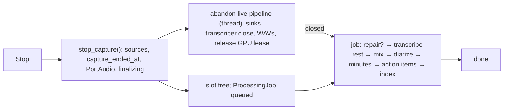
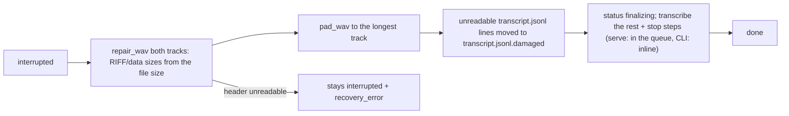
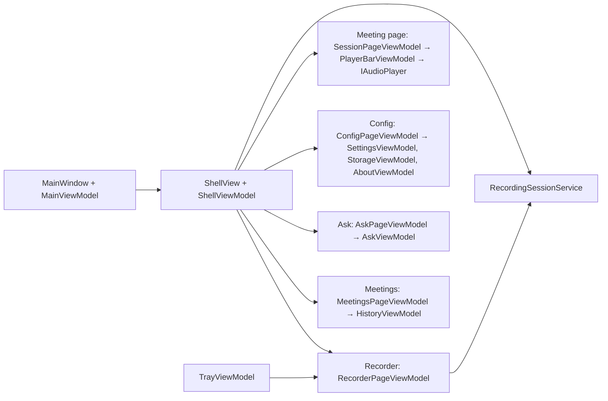
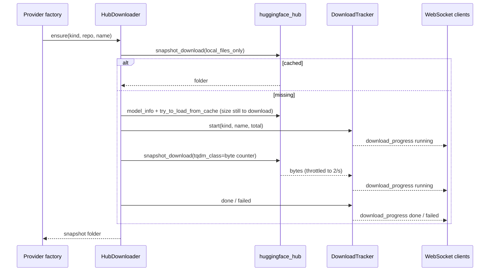

# Architecture

Shared reference for every phase. If a phase changes something described here, it updates this file
in the same branch.

## 1. Environment facts (verified 2026-10-15)

| Item | State |
|------|-------|
| OS | Windows 11 Pro |
| Python | 3.13, virtualenv at repo root `.venv/` (reused by the engine — do not move it). On the reference machine `.venv` is a directory junction to `<local-venv>` (a virtualenv outside OneDrive), because the repo lives in OneDrive |
| Installed in `.venv` | faster-whisper 1.2, ctranslate2, nvidia-cublas-cu12, nvidia-cudnn-cu12 9, PyAudioWPatch, soxr, numpy 2 |
| GPU | NVIDIA RTX 3050 Laptop, **6 GB VRAM** |
| Tools | ffmpeg, git, gh, docker |
| Missing | **.NET SDK** (install .NET 10 LTS in phase 07), Ollama CLI not on PATH (install + `ollama pull` in phase 04) |
| Repo | GitHub `laquilas/VozAta` (public), default branch `main`; CI: quick checks (lint, format, compile) on pull requests into `main`; full test suites and the installer on `v*` tags and manual runs |

### Legacy code (`__legacy__/`, read-only reference)

Working prototypes on this machine, **not published** (git-ignored; copy them from `<prototype-workspace>/__legacy__`). Adapt their logic; never import from them.

| File | Reuse |
|------|-------|
| `__legacy__/gravar_reuniao.py` | `Fonte`: PyAudioWPatch callback → queue, downmix, `soxr.ResampleStream` to 16 kHz, clock-aligned WAV writing with silence fill (loopback delivers no data when nothing plays), `finalizar` pads both WAVs to equal length. `misturar_estereo`: streamed L/R mix in 60 s blocks. Device discovery: `get_default_input_device_info()`, `get_default_wasapi_loopback()`. |
| `__legacy__/transcrever.py` | CUDA DLL path setup (`os.add_dll_directory` for `nvidia/cublas/bin` and `nvidia/cudnn/bin` in site-packages); `carregar_modelo`: GPU load + 1 s warm-up probe, fallback to CPU `small` int8. |
| `__legacy__/transcricao_ao_vivo_v2.py` | Live worker loop and RMS-based speech gating (superseded by the stitcher). |

## 2. Repository layout (target)

```
.venv/                      shared Python virtualenv
__legacy__/                 read-only prototypes
docs/roadmap/               this roadmap
engine/
  pyproject.toml
  .env.example
  src/vozata/
    __main__.py             CLI: record | minutes | recover | reindex | serve
    config.py               Settings (only module reading env vars)
    domain.py               dataclasses / enums (no I/O)
    ports.py                typing.Protocol interfaces
    bootstrap.py            composition root + provider registries
    i18n.py                 TomlLocalizer
    labels.py               SpeakerLabeler (speaker_id → display label)
    formatting.py           timestamps, transcript line rendering
    language.py             conversation-language resolution
    vocabulary.py           glossary store + hint building (19)
    locales/{en,pt-BR,es}.toml
    session.py              RecordingSession
    audio/                  devices.py, capture.py, clock.py, wav_writer.py, chunker.py, mixer.py, levels.py,
                            pcm.py (playable tracks, WAV header, 32)
    transcription/          cuda.py, faster_whisper.py, openai_compatible.py, retry.py,
                            stitcher.py, language_lock.py, worker.py, echo.py
    output/                 sinks.py
    llm/                    ollama.py
    minutes/                generator.py, prompts.py, template_repository.py, templates/, action_items.py, session_action_items.py
    diarization/            pyannote.py, assign.py, embedder.py, live.py, models.py (repo ids, 42)
    models/                 download.py (HubDownloader), byte_counter.py, tracker.py (DownloadTracker), cli_progress.py (42)
    storage/                session_store.py, recovery.py, wav_repair.py, search_index.py, action_items.py,
                            audio_cache.py (32), files/{repository,audio,layout,repair,translations,folder}.py
                            (file backend, 30), sqlite/{db,repository,search,audio,audio_writer,...}.py (31, 32)
    export/                 markdown.py, docx.py, pdf.py, fonts/, tasks/{azure_devops,github,http,session_export}.py
    qa/                     retriever.py, citations.py, answerer.py
    translation/            worker.py, opus_mt.py, live.py (29)
    api/                    app.py, schemas.py, ws.py, session_manager.py, system_info.py, routes/*.py
  tests/                    mirrors src/
ui/
  VozAta.sln
  src/VozAta.Client/        IEngineClient, DTOs, WebSocket event stream
  src/VozAta.Desktop/       Avalonia app (Views, ViewModels, Services, Resources/Strings*.resx)
  tests/VozAta.Desktop.Tests/
```

## 3. SOLID mapping

- **S** — one responsibility per class: capture, WAV writing, chunking, transcription, stitching,
  mixing, minutes generation, sinks, storage, export are separate units.
- **O** — providers (STT, LLM, diarizer, task exporter, mixer, export format) are registered in
  factory registries in `bootstrap.py`; adding one never edits `RecordingSession` or the API.
- **L** — every implementation honours its port's contract (e.g. all transcribers return
  chunk-relative word timestamps and an empty result on silence; none raise for silence).
- **I** — small Protocols with 1–3 methods each.
- **D** — orchestrators (`RecordingSession`, `MinutesGenerator`, API routes) depend on ports only;
  `bootstrap.py` (engine) and `App.axaml.cs` (UI) are the only places that know concrete classes.

## 4. Domain types (`domain.py`)

```python
class Channel(StrEnum): MIC = "mic"; SYSTEM = "system"
class AudioTrack(StrEnum): MIC = "mic"; SYSTEM = "system"; MIXED = "mixed"  # playable tracks (32)
class SessionStatus(StrEnum): RECORDING, PAUSED, FINALIZING, DONE, INTERRUPTED  # lowercase values
class AppLanguage(StrEnum): EN = "en"; PT_BR = "pt-BR"; ES = "es"
class ConversationLanguage(StrEnum): EN = "en"; PT = "pt"; ES = "es"; AUTO = "auto"
class ChunkMode(StrEnum): VAD = "vad"; FIXED = "fixed"

@dataclass(frozen=True) class AudioChunk:      channel, start: float, samples: np.ndarray  # float32 mono, SAMPLE_RATE
                                               complete: bool = False  # ends in a pause (27)
@dataclass(frozen=True) class Word:            text, start, end, probability
@dataclass(frozen=True) class TranscriptionResult: words: tuple[Word, ...], language: str | None,
                                                   avg_logprob: float | None = None  # mean segment log probability (19)
@dataclass(frozen=True) class TranscriptSegment:
    segment_id: str; channel: Channel; speaker_id: str; start: float; end: float
    text: str; words: tuple[Word, ...]
    edited: bool = False  # user-corrected text (21); words then empty
@dataclass(frozen=True) class SpeakerTurn:     start, end, speaker_index: int
@dataclass(frozen=True) class ExportDocument:  title, details, minutes_title, minutes_markdown, minutes_blocks: list[Block],
                                               no_minutes, transcript_title, columns, rows: list[Row]  # localized (11)
@dataclass(frozen=True) class ActionItem:      id, description, owner: str | None, due: str | None,
                                               source_segment_ids: tuple[str, ...], exported_url: str | None  # (23)
@dataclass(frozen=True) class TaskDraft:       title, body, due: str | None  # one item to export, body localized (23)
```

All times are **seconds since session start** (float).

Helpers: `default_conversation_language(app_language)` maps `APP_LANGUAGE` to the default spoken
language (`pt-BR` → `pt`). `AudioChunk` uses identity equality (`eq=False`) because of its array field.

## 5. Ports (`ports.py`)

```python
class AudioSource(Protocol):
    def start(self, on_samples: Callable[[np.ndarray, float], None]) -> None: ...  # samples, session time
    def stop(self) -> None: ...
class AudioSink(Protocol):           # AlignedWavWriter
    def write(self, samples: np.ndarray, at: float) -> None: ...
    def finalize(self, total_seconds: float) -> None: ...
class Transcriber(Protocol):
    def transcribe(self, samples: np.ndarray, language: str | None, hints: str | None = None,
                   prompt: str | None = None) -> TranscriptionResult: ...  # hints = vocabulary, prompt = rolling context (19)
    def close(self) -> None: ...     # releases GPU memory
class FallbackNotices(Protocol):     # phase 44: ObserverNotices (`error` worker_fallback) / LoggedNotices
    def fallback(self, task: str, host: str) -> None: ...  # `task` runs on this PC: the worker did not answer
# WorkerUnreachableError(host): the VozAta worker did not answer at all (WorkerClient, phase 44)
class TranscriptSink(Protocol):
    def emit(self, segment: TranscriptSegment) -> None: ...
    def close(self) -> None: ...
class AudioMixer(Protocol):           # MIXERS[MIX_MODE]; reads the tracks through an AudioReader (30)
    channels: int                     # 1 (mono sum) or 2 (mic left, system right)
    def mix(self, reader: AudioReader, session_id: str, destination: Path) -> None: ...
    def combine(self, mic: np.ndarray, system: np.ndarray) -> np.ndarray: ...  # one block, for the mix on read (32)
class Chunker(Protocol):             # FixedWindowChunker (01), VadChunker (27)
    paused: bool
    def feed(self, samples: np.ndarray, at: float) -> None: ...
    def flush(self) -> None: ...
    def buffered(self) -> AudioChunk | None: ...  # copy of the audio not emitted yet (28)
class SpeechDetector(Protocol):      # SileroSpeechDetector (27); unpadded spans in seconds
    def speech_spans(self, samples: np.ndarray) -> list[tuple[float, float]]: ...
class LanguageModel(Protocol):
    def generate(self, system: str, prompt: str, json_schema: dict | None = None) -> str: ...
    def stream(self, system: str, prompt: str) -> Iterator[str]: ...
    def is_available(self) -> bool: ...
    def release(self) -> None: ...   # after a job: unload per OLLAMA_KEEP_ALIVE (25)
class Diarizer(Protocol):             # SubprocessDiarizer → PyannoteDiarizer in a child process (14)
    def diarize(self, wav: Path, min_speakers: int | None, max_speakers: int | None) -> list[SpeakerTurn]: ...
    def close(self) -> None: ...      # raises DiarizationError from diarize() on failure
class SpeakerEmbedder(Protocol):      # SubprocessEmbedder → PyannoteEmbedder in a long-lived child (15)
    def embed(self, samples: np.ndarray) -> np.ndarray: ...  # 1-D vector; raises on failure
    def close(self) -> None: ...
class DocumentExporter(Protocol):     # Markdown, DOCX, PDF (11)
    media_type: str; extension: str
    def export(self, document: ExportDocument) -> bytes: ...  # built once by export.document.build_document
class TaskExporter(Protocol):        # TASK_EXPORTERS registry (23): azure_devops, github
    name: str                        # display name, e.g. "Azure DevOps"
    def create(self, task: TaskDraft) -> str: ...  # created item URL; raises TaskExportError(code, **params)
class Localizer(Protocol):
    def t(self, key: str, /, **params: object) -> str: ...  # key is positional-only
class SessionObserver(Protocol):     # console (05), WebSocket broadcaster (06); called from worker threads
    def on_status(self, status: SessionStatus, duration_seconds: float) -> None: ...
    def on_level(self, channel: Channel, rms_db: float) -> None: ...
    def on_segment(self, segment: TranscriptSegment) -> None: ...
    def on_language_detected(self, language: ConversationLanguage) -> None: ...
    def on_minutes_ready(self, session_id: str) -> None: ...
    def on_action_items_ready(self, session_id: str, count: int) -> None: ...  # (23)
    def on_speakers_relabeled(self, session_id: str) -> None: ...  # post-session speakers written (15)
    def on_model_loading(self, loading: bool) -> None: ...  # speech model loading while recording (26)
    def on_partial(self, channel: Channel, speaker_id: str, start: float, text: str) -> None: ...  # interim (28)
    def on_translation(self, segment_id: str, language: str, text: str) -> None: ...  # live translation (29)
    def on_error(self, code: str, message: str) -> None: ...  # message is localized
class Translator(Protocol):           # OpusMtTranslator (29), CPU; built on the translation thread
    def translate(self, text: str, source: str, target: str) -> str: ...  # raises TranslationError
    def close(self) -> None: ...
class ModelDownloader(Protocol):      # HubDownloader (42): every local model (Whisper, pyannote, Opus-MT)
    def ensure(self, kind: ModelKind, repo_id: str, *, allow_patterns: Sequence[str] | None = None,
               token: str | None = None, name: str | None = None) -> Path: ...  # cached snapshot folder
class TranscriptSearch(Protocol):     # SearchIndex (22, files) / SqliteSearch (31, sqlite); reused by 21 and 24
    def index_session(self, session_id: str, segments: Sequence[TranscriptSegment]) -> None: ...  # replace (SqliteSearch: no-op, triggers)
    def search(self, query: str, limit: int = 50) -> list[SearchHit]: ...  # free text, best first

# Storage (30-32): every read and write of session data. REPOSITORIES / AUDIO_STORES / SEARCHES
# in bootstrap.py, keyed by STORAGE_BACKEND (sqlite | files). Shared contract suites:
# tests/storage/repository_contract.py and tests/storage/audio_contract.py.
class SessionRepository(Protocol):    # SqliteSessionRepository (31), FileSessionRepository (30); raises SessionNotFoundError
    def now(self) -> datetime: ...
    def create(self, started_at: datetime | None = None) -> str: ...  # id YYYYMMDD_HHMMSS[_n]
    def discard(self, session_id: str) -> None: ...
    def read_meta(self, session_id: str) -> dict: ...; def write_meta(self, session_id: str, meta: dict) -> None: ...  # atomic
    def list_sessions(self) -> list[str]: ...  # with metadata, newest first
    def open_transcript(self, session_id: str, labeler: SpeakerLabeler) -> TranscriptSink: ...  # durable per segment
    def load_transcript(self, session_id: str) -> list[TranscriptSegment]: ...  # edited > diarized > raw
    def load_transcript_with_source(self, session_id: str) -> tuple[str, list[TranscriptSegment]]: ...
    def load_raw_transcript(self, session_id: str) -> list[TranscriptSegment]: ...
    def load_source(self, session_id: str, source: str) -> list[TranscriptSegment]: ...  # (39) raw | diarized | edited
    def write_diarized(...) / write_edited(...) / delete_edited(session_id) -> bool
    def open_translations(self, session_id: str) -> TranslationWriter: ...  # append(Translation), close()
    def load_translations(self, session_id: str) -> dict[str, Translation]: ...  # last one wins
    def speaker_names(...) / write_speakers(session_id, ids) / rename_speakers(session_id, names)
    def speaker_ids(self, session_id: str) -> list[str]: ...  # (39) every speaker, named or not, in order
    def read_minutes(self, session_id: str) -> str | None: ...; write_minutes(session_id, markdown); has_minutes(session_id)
    def read_action_items(...) / write_action_items(...) / action_items_lock() -> context manager
    def read_partial_minutes(session_id) -> list[PartialMinutes]  # phase 48, oldest first
    def write_partial_minutes(session_id, items) -> None          # replaces them all
    def folder(self, session_id: str) -> Path | None: ...  # the session folder (files); sqlite: None (32)
    def files(self, session_id: str) -> list[str] | None: ...  # idem
    def list_range(self, start: datetime, end: datetime) -> list[str]: ...  # (36) started in [start, end), newest first
    def speaker_count(self, session_id: str) -> int: ...  # (36) system:<n> speakers found by diarization
    def delete(self, session_id: str) -> None: ...  # (36) sqlite: permanent (audio chunks cascade); files: folder to the Recycle Bin
class Recycler(Protocol):             # (36) Send2TrashRecycler; tests: FakeRecycler (never the real bin)
    def recycle(self, path: Path) -> None: ...
class AudioTrackWriter(AudioSink, Protocol):  # AlignedWavWriter / SqliteTrackWriter; gaps and pauses become silence
    paused: bool; samples_written: int
class AudioStore(Protocol):           # FileAudioStore (30), SqliteAudioStore (32)
    def open_writer(self, session_id: str, channel: Channel) -> AudioTrackWriter: ...
    def write_mix(self, session_id: str, mixer: AudioMixer) -> None: ...  # files: mixed.wav; sqlite: nothing (mixed on read)
    def delete(self, session_id: str) -> None: ...  # (32) after DELETE /sessions/{id}: sqlite drops cached WAVs, reclaims space; files: nothing
    def discard(self, session_id: str) -> None: ...  # (39) DELETE /sessions/{id}/audio: sqlite as delete; files: WAVs to the Recycle Bin
class AudioReader(Protocol):          # int16 mono samples
    def frames(self, session_id: str, channel: Channel, start: int, count: int) -> np.ndarray: ...
    def length(self, session_id: str, channel: Channel) -> int: ...
    def sample_rate(self, session_id: str, channel: Channel) -> int: ...
    def materialize_wav(self, session_id: str, channel: Channel | AudioTrack) -> Path: ...  # files: the WAV itself; sqlite: cache/<id>/<track>.wav
class PcmTrack(Protocol):             # a playable track (32): ChannelTrack, MixedTrack, WavFileTrack
    rate: int; channels: int; frames: int
    def read(self, start: int, count: int) -> bytes: ...  # interleaved little-endian int16 frames
class AudioTracks(Protocol):          # GET /sessions/{id}/audio/{track} (32)
    def track(self, session_id: str, track: AudioTrack) -> PcmTrack | None: ...  # None: no such audio
class AudioCache(Protocol):           # (32) WavCache, OUTPUT_DIR/cache: GET /health size, DELETE /storage/cache (38)
    def size(self) -> int: ...; def clear(self) -> int: ...  # clear skips files in use, returns bytes freed
class SessionAudio(AudioStore, AudioReader, AudioTracks, Protocol): ...  # what RecordingSession gets
class BundleImporter(Protocol):       # (39) SqliteBundleImporter (FolderImporter), FileBundleImporter (moves into OUTPUT_DIR)
    def import_folder(self, folder: Path) -> ImportedSession: ...  # mode imported | audio_restored; BundleError, SessionExistsError
class RecoverableStore(Protocol):     # crash recovery (17); run in order: [audio, repository] (sqlite: audio only)
    def repair(self, session_id: str) -> float | None: ...  # recorded seconds if it holds audio; StoreRepairError
```

Ports are added by the phase that first needs them; the list above is the target.

## 6. Data flow

```
WasapiSource(mic) ─┬─> AlignedWavWriter → mic.wav
                   └─> Chunker (vad | fixed) ─┐
WasapiSource(sys) ─┬─> AlignedWavWriter → system.wav
                   └─> Chunker (vad | fixed) ─┴─> Queue[AudioChunk]
                                               └─> TranscriptionWorker (single thread, one GPU)
                                                    └─> CarryOverStitcher (one per channel)
                                                         └─> Transcriber
                                                    └─> [EchoFilter] → [LiveSpeakerSink → LiveSpeakerTagger]
                                                    └─> CompositeSink → Console | Jsonl | Markdown | WebSocket
                                                                        | [TranslationWorker] (29)
```

**Live translation** (phase 29, `TRANSLATE_TO` or the Start screen choice): the
`TranslationWorker` (`translation/worker.py`) is one more sink of the composite (passed to
`CapturePipeline` as `extra_sinks`, so it sees segments after echo dedupe and live speakers). `emit` only enqueues;
its own thread builds the translator (`TRANSLATORS[TRANSLATION_PROVIDER]`, model load off the
transcription thread), then translates the queue in order on **CPU** and writes each result to
`transcript.translated.jsonl` and the `translation` event (`SessionObserver.on_translation`). The
source language is the session's `LanguageLock`: in `auto`, segments wait until it locks (and once
more at stop). Segments already in the target language and blank texts are skipped. The first
failure (missing extra, download, model error) reports `error` `translation_failed` once and
disables translation for the session; transcription is never affected. Closing the composite at
stop step 1 translates what is still queued, then frees the translator. Provider choice: §14.

**Chunkers**: `CHUNKERS[CHUNK_MODE]` in `bootstrap.py` builds one per channel through
`SessionComponents.chunker_factory`. `VadChunker` (27, default) asks a `SpeechDetector`
(`SileroSpeechDetector`, CPU) every 0.25 s and cuts in the middle of pauses ≥ `VAD_MIN_SILENCE_MS`,
marking those chunks `complete`; `FixedWindowChunker` cuts every `CHUNK_SECONDS`.

**Interim text** (phase 28, `LIVE_PARTIALS`): when the chunk queue is empty, the worker previews
each channel's uncommitted audio (stitcher carry + `Chunker.buffered()`, copied under the track
lock) at most once per `PARTIAL_INTERVAL_SECONDS`, only with ≥ 1 s of voiced audio, and sends
changed text through `on_partial` (API `partial`), never to the transcript files. A segment
replaces it; an empty `partial` clears it when the channel's next chunk commits nothing, and at
stop.

**Echo dedupe** (phase 18, `ECHO_DEDUPE_ENABLED`): without headphones the microphone also hears
the remote participants from the speakers. `EchoFilter` (`transcription/echo.py`) wraps the
composite sink: system segments pass through at once and are kept for 30 s; each mic segment is
held for `ECHO_HOLD_SECONDS` (default `CHUNK_SECONDS + 3`) so the matching system segment can
arrive, and is dropped when at least `ECHO_SIMILARITY` of its words (lowercased, punctuation-free,
`difflib.SequenceMatcher` on word lists) are found, in order, in the system words spoken within
its span ± 1 s. Partial echo (the user talking over the remote speaker) stays below the threshold
and is kept. The worker calls `EchoFilter.tick()` after every chunk and idle wait to release
expired holds; closing the sink at stop (step 1) releases whatever is still held. Cost: **mic
lines reach the transcript files and the UI up to `ECHO_HOLD_SECONDS` later** than system lines
(system lines are never delayed), so `transcript.jsonl` is not strictly ordered by `start`. A
dropped mic segment also clears the mic interim text. The drop count is `session.json`
`echo_dropped`.

**Live speakers** (phase 15, `LIVE_DIARIZATION_ENABLED`): `LiveSpeakerSink`
(`diarization/live_sink.py`) wraps the composite sink behind the echo filter and forwards every
segment, in order, from its **own thread**; the transcription worker only enqueues, so a slow
embedding never delays transcription. System chunks are also kept in an `AudioHistory`
(60 s + `MAX_CARRY_SECONDS`), which cuts each system segment's clip by session time. The
`LiveSpeakerTagger` (`diarization/live.py`) embeds the clip and compares it (cosine) with each
speaker's running centroid: at or above `SPEAKER_SIMILARITY_THRESHOLD` → that `system:<n>`,
otherwise a new speaker; segments under 1 s, without audio or with an unusable vector reuse the
previous speaker. The embedder loads on a second thread (lines before it is ready keep `system`);
a failed load reports `error` `live_diarization_failed`. An embedding slower than
`CHUNK_SECONDS`, or an embedder error, turns the tagger off with a warning for the rest of the
session. Live speakers are written to `transcript.jsonl` and sent in `segment` events; closing
the sink at stop (step 1) forwards what is queued and ends the embedder process.

**Threads**: one capture callback + one consumer thread per source; one transcription worker;
the API runs in the asyncio loop and receives events through a thread-safe broadcaster. If the
chunk queue backlog exceeds 3 chunks per channel, log a warning (transcription slower than real time).

**Start** (capture first, phase 26): create the session folder, start the clock, then open each
source with a timeout (`SOURCE_OPEN_TIMEOUT`, 20 s): a WASAPI open can hang in
the driver. A source that fails or times out aborts the start (`SessionStartError` with code
`device_timeout` / `device_failed` and a localized message), closes everything and deletes the
empty session folder. Once every source is open the status is `recording` and the transcription
worker loads the transcriber on its own thread (`on_model_loading(True/False)`, API event
`model_loading`); chunks captured meanwhile wait in the queue and are transcribed afterwards
(the backlog warning stays silent while catching up). A failed load reports `error`
`model_failed`; the WAVs keep recording and the queued chunks are dropped.

**Audio only** (phase 41, `live_transcription` false): `CapturePipeline(live=False)` keeps only
the writers and level meters (pause still writes silence). No chunker, transcription worker,
transcript files, echo filter, interim text, live speakers or translation are built, no model is
loaded and the GPU gate is never held. At Stop the WAVs are finalized on the caller's thread, so
`closed` is set before `stop_capture()` returns; the job's `transcribe` step then transcribes the
whole recording (the raw transcript is empty, so every channel starts at 0).

**PortAudio thread**: WASAPI binds PortAudio's host state to the thread that initialized it (COM);
streams opened from another thread fail with "Unanticipated host error" (-9999). `bootstrap.py`
creates one `PortAudioThread` per session that owns the `PyAudio` instance and runs device lookups,
stream opens and `terminate()`; the session releases it once capture has stopped.

**Stop order** (phase 40: Stop frees the recorder; the rest runs in the processing queue):
1. `RecordingSession.stop_capture()` (returns at once): stop sources; flush chunkers (last partial
   window); `duration_seconds` and `capture_ended_at` in `session.json`; release PortAudio;
   `status = finalizing`; stop the heartbeat; **abandon** the live pipeline: the transcription
   worker finishes the chunk (or model load) in hand and skips its backlog and stitcher flush;
   then, on its thread, the sinks close (the echo filter releases held mic segments, translation
   and live speakers end), `transcriber.close()` (free VRAM), the tracks are finalized to the same
   length (max written samples), `echo_dropped` is saved and the session's live GPU lease is
   released; last, the returned `closed` event is set. A failing part (e.g. `session.json` locked
   by OneDrive) is logged and the rest still runs; the pipeline is always abandoned. From capture
   end on, `SessionMeta` merges every change into the stored `session.json` (a rename or the job
   may write it meanwhile). A new recording's capture starts at once, but its models load only
   once the previous session's `closed` is set (`LiveModelTurn`): never two live Whisper models.
2. `serve`: `SessionManager.stop()` runs step 1 on a short-lived thread, then (under its lock)
   frees the recording slot and puts the meeting's `ProcessingJob` on the `ProcessingQueue`
   (`bootstrap.build_processing_job`). `POST /sessions` sent before the slot is free waits for it
   (outside the lock, up to 10 s, `stop_wait`), then starts; only a slot still taken after that
   answers `409 session_already_active`. CLI `record`: `RecordingSession.stop()`
   runs the same job inline (`run_job_inline`), with the session's own components.
3. The job (`processing/session_job.py`, composed by `bootstrap_processing.py`) waits for
   `closed` (`before`, no timeout, a warning every 5 min), then runs its steps in order; each
   attempt builds only the provider it uses when it runs (the diarizer, the minutes generator or
   the action-item extractor, each with its own language model client) and closes the language
   model clients it built when the attempt ends (`SessionFinisher.close()`):
   - `repair` (crash recovery only): the `RecoverableStore`s of the backend, length stored.
   - `transcribe` (GPU when speech runs on CUDA): `OfflineTranscription` transcribes, from the
     stored tracks, whatever the raw transcript does not cover yet (each channel from its last
     segment; the whole meeting when the model was still loading at Stop), in the conversation
     language stored in `session.json`. Weight `2 + 60 × left / duration`. With
     `WHISPER_KEEP_LOADED` and speech on the GPU it leases the shared Whisper (no second model);
     an attempt cancelled by a live start keeps it loaded (the live session leases it next).
   - `mix`: `AudioMixer` → `mixed.wav` (file backend; with `sqlite` the mix is computed on read).
   - `diarize` (if `DIARIZATION_ENABLED`; GPU when pyannote runs on CUDA): diarize the system
     track (`materialize_wav(id, system)`: `system.wav`, or with `sqlite` a WAV built in the
     cache) → `assign_speakers` → `transcript.diarized.jsonl` + `speakers.json` →
     `diarizer.close()` → `speakers_relabeled` (15: clients reload the transcript; these speakers
     replace the live ones). A failure (missing extra or `HF_TOKEN`, model error) logs a warning,
     reports `error` `diarization_failed` (with the `python -m vozata diarize` retry command) and
     keeps the `system` labels.
   - `minutes` (if `GENERATE_MINUTES`; GPU with local Ollama): `MinutesGenerator` → `minutes.md`,
     then `llm.release()` (Ollama unloads per `OLLAMA_KEEP_ALIVE`, also after a failed job;
     after a cancel always at once, `keep_alive` 0, since the GPU is needed by a live user).
     An Ollama that does not answer (43) fails the step in about 3 s: the first request of a model
     is a `GET /api/tags` probe, a connection failure raises `LlmUnreachableError`, the step
     reports `llm_unreachable` (no `release()` is sent to a dead host) and the queue goes on; the
     meeting ends `done` without minutes and "Regenerate minutes" retries later.
   - `action_items` (if `EXTRACT_ACTION_ITEMS` too): `ActionItemExtractor` → `action_items.json`
     (items already exported are kept), `on_action_items_ready` (23; a failure reports
     `action_items_failed`).
   - `index`: the session for search.
4. `on_finished`: `status = done`, `ended_at` set in `session.json`, `status: done` event.

A failing step reports its `error` event and the job continues with the next one; the queue never
stops on one meeting's failure.



**Processing queue** (phase 40, `processing/queue.py`): one daemon worker thread runs one job at a
time, FIFO in stop order, and publishes a `ProcessingState` (queued with position / running /
paused / done / failed, step-weighted percent that never goes down) on every state or step change
and at most once per second while the percent moves. At `serve` shutdown (app lifespan, before
the kept Whisper is released) `queue.stop()` cancels the running step attempt (an LLM request
closed, a diarizer child terminated, transcription stopped between blocks) and runs no further
step or job; the meeting stays `finalizing` and the next start resumes it.

**GPU gate** (phase 40, `processing/gpu_gate.py`, one per engine, built in `bootstrap.py`):
`gpu_usage(settings, cuda)` says which model families run on the local GPU (speech: faster-whisper
not on CPU; speakers: pyannote not on CPU; LLM: Ollama on this PC; an Ollama on another PC (43, `net.py`: `OLLAMA_URL` is not loopback) is not local GPU work, and Whisper is not unloaded before it; speech on the VozAta worker (44) is not local GPU work either, but `speech_fallback` marks that its fallback would load Whisper here: a live session takes the gate only when it falls back, and the queue's transcribe step is gated); without CUDA nothing is gated. Priority:
live recording > Ask > Config tests > queue. A live session takes `gate.priority(LIVE)` on the
model-load thread before a live model that runs on the local GPU loads (`LiveGpuLease`: the speech
model when `usage.speech`, the live speaker embedder when `usage.live_speakers`, i.e.
`LIVE_DIARIZATION_ENABLED` not on CPU; post-session diarization on the GPU does not count, so a
recording with external or CPU speech leaves the queue alone) and gives it back once its abandoned
pipeline closed. A session stopped before a live model started loading (or while waiting for the
previous session's models to close, `LiveModelTurn`) skips that load silently: no gate, no model. Taking a priority cancels
the queue's running GPU step (it must stop within 5 s; its partial output is discarded) and the job
shows `paused`; the step is redone from its start, with fresh providers, once no priority is held
(the transcribe step resumes from what it already wrote). Steps without GPU are never cancelled.

**Crash recovery** (phase 17): while a session is active (from `recording` until `done`) a
heartbeat rewrites `session.json` every `AUTOSAVE_SECONDS` with `last_heartbeat_at` and
`duration_seconds`, and `JsonlSink` fsyncs every segment. On the next start, a session still
`recording` / `paused` / `finalizing` that is not live is marked `interrupted`
(`storage/recovery.find_interrupted`; one with `capture_ended_at` is skipped, it is re-queued instead, see below; `serve`: not live in this process, sent to each WebSocket
client as `recovery_available`; CLI: also no heartbeat for `2 * AUTOSAVE_SECONDS + 5` s, so a
session another process records is left alone; the heartbeat stops at capture end, so a CLI
`record` meeting still in its inline job is not mistaken for a crash by another process's
`recover --all`).

**Restart** (phase 40): `SessionManager.resume_pending()` runs at `serve` start, before the folder
import and before `recovery_available` is first computed. Every session `finalizing` with
`capture_ended_at` that is not live is enqueued, oldest first, with the `repair` step first; that
includes a meeting whose job could not be created at Stop. `POST /sessions/{id}/recover` enqueues
the same job for an `interrupted` session and also makes it `finalizing` with a `capture_ended_at`
once repaired, so a further restart resumes it. The repair step is `SessionRecovery.repair` (files
and transcript, below); when it fails the step stores `recovery_error`, marks the session
`interrupted`, sends `error` `recovery_failed` and aborts the job (`AbortJob`): it ends `failed`
and no later step runs. The transcribe step then continues from each channel's last committed
segment (`resume_points`), after the repair set a half-written last line aside. Recovering:
`POST /sessions/{id}/recover` enqueues that job; `python -m vozata recover [<dir> | --all]` runs
the same job inline (`build_resume_job`: repair, transcribe the rest from the stored audio, stop
steps) for each `interrupted` session. `SessionRecovery` only finds and repairs; there is no
other recovery path. A meeting a CLI `record` left `finalizing` with
`capture_ended_at` (it crashed in its inline job) is not listed by `recover --all`, since another
process may still be running it; it is resumed by `serve` at start or by `recover <dir>`, which
runs the same job (repair, transcribe the rest, stop steps) inline. Known limitation: a `serve`
started while a CLI `record` is still running that inline job re-queues the meeting too (the queue
is per process).



With the SQLite backend (phase 32) the committed audio chunks are the recording: there is no
`repair_wav`; `SqliteAudioStore.repair` pads the shorter channel with silence chunks to the
longer one and returns the length. Audio lost in a crash is at most the chunk being filled
(≤ 1 s) plus the batch not committed yet (≤ 1 s, more only if the writer had fallen behind).

The recovered session uses the template, glossary and `MIX_MODE` stored in its `session.json`
and the current settings for the rest (diarization, minutes on/off). Nothing is deleted: a
missing or empty WAV becomes a valid empty one; the transcript lines already flushed are kept and
only the last unfinished window (≤ `CHUNK_SECONDS` + carry) is lost. In `serve` a recovery is a
queue job: it never holds the recording slot, and the GPU gate keeps its GPU steps off a live
recording (VRAM rule). Recovering is idempotent: a `done` session is never touched again.

**VRAM rule (6 GB)**: never keep Whisper, the diarizer and the Ollama model loaded at the same
time; the job's step order (each step closes its model) and the GPU gate enforce that. The live speaker embedder (15, ~30 MB model plus the
child's CUDA context) is the one exception next to Whisper while recording; it ends at step 1. With `WHISPER_KEEP_LOADED` (`serve`, phase 26) a
`SharedTranscriber` keeps Whisper between sessions only when neither minutes nor speaker
identification follow; it is unloaded
before session minutes, before `POST /sessions/{id}/minutes` and when the API stops. Leases are
counted: an unload asked for (a lease without keep, or `release()`) while another lease is open
happens when the last open lease closes, never under a model that is transcribing.

**Pause/resume**: while paused, sources keep running (keeps the clock aligned) but chunkers drop
audio and WAV writers write silence; a `paused` marker is recorded in `session.json`.

## 7. Stitching algorithm (`CarryOverStitcher`)

Problem: fixed `CHUNK_SECONDS` windows (and forced VAD cuts) cut words and sentences. Solution: carry the unfinished
tail audio into the next window and re-transcribe it.

```
state per channel: pending: np.ndarray (may be empty), pending_start: float

on_chunk(chunk):
    audio = concat(pending, chunk.samples); audio_start = pending_start if pending else chunk.start
    if pending is empty and rms(audio) < SILENCE_RMS_THRESHOLD: return []        # no STT call
    result = transcriber.transcribe(audio, language, hints, context.take(audio_start))  # (19)
    if no words: pending = empty; return []
    if chunk.complete: pending = empty; return [segment(words, offset=audio_start)]  # VAD cut (27)
    duration = len(audio) / SAMPLE_RATE
    safe = [w for w in words if w.end <= duration - TAIL_MARGIN_SECONDS]
    cut_word = last w in safe ending with . ? ! (or … )
            or last w in safe where next_word.start - w.end >= PAUSE_GAP_SECONDS
            or None
    if cut_word is None and duration >= MAX_CARRY_SECONDS: cut_word = words[-1]   # force
    if cut_word is None: pending, pending_start = audio, audio_start; return []
    committed = words up to and including cut_word
    cut_time = midpoint(cut_word.end, next_word.start)
            or voiced_end(cut_word.end) if it is the last word   # see note below
    pending = audio[cut_time * SAMPLE_RATE :]; pending_start = audio_start + cut_time
    return [segment(committed, offset=audio_start)]

flush(): transcribe pending (if any) and commit every word.

partial(tail):  # interim text (28): pending + chunker.buffered(), ≥ 1 s voiced; commits nothing,
                # does not feed the language lock
```

Committed audio is dropped, so no text is duplicated.

Whisper word end timestamps run early. When the cut word is the last word of the window, `voiced_end` extends the
cut through still-voiced 10 ms frames (RMS ≥ `SILENCE_RMS_THRESHOLD`), at most 0.3 s, so the tail of that word is
not carried and re-transcribed as a fragment (found by the phase 03 GPU smoke test: "meeting." + "eating."). Re-transcribing the carried tail costs at most
`MAX_CARRY_SECONDS` of extra audio per window.

## 8. Data model and session folder

Two storage backends, chosen by `STORAGE_BACKEND` (restart): **`sqlite`** (default since phase
31) keeps sessions, transcripts, speakers, translations, minutes, action items and the search
index in one database, `vozata.db`, and since phase 32 the audio too, as ≈1 s PCM chunks (see
*SQLite backend* below); **`files`** keeps the folder layout of the table below, WAVs included.
Phase 33 imports existing folders. The
desktop UI moves to a Toggl Track–style shell (sidebar, timer bar, pages) with theme tokens in
phases 34–38.

### SQLite backend (phase 31)

`vozata.db` lives at `DATABASE_PATH` (empty = `OUTPUT_DIR/vozata.db`); `storage/sqlite/` and
`bootstrap.py` are the only modules that know it. **Keep it out of OneDrive-synced folders**:
OneDrive locks the file while uploading and syncs it without its `-wal` file, which can corrupt
a database in use. The engine logs a warning when it opens a database under a OneDrive root
(`OneDrive` / `OneDriveConsumer` / `OneDriveCommercial` environment variables, plus the
`UserFolder` of every account under `HKCU\Software\Microsoft\OneDrive\Accounts` on Windows: the
variables can miss a personal OneDrive next to a business one) and
`GET /health` shows it as `storage.warning`; it does not refuse to start.

- **Connections** (`storage/sqlite/db.py`, `Database`): one per thread (`threading.local`),
  `journal_mode=WAL`, `synchronous=NORMAL`, `foreign_keys=ON`, `busy_timeout=10000`; writes are
  serialized by one lock and run in `BEGIN IMMEDIATE` transactions. A live transcript segment is
  committed with `synchronous=FULL` before `emit` returns, so every emitted segment survives a
  crash and recovery has nothing to repair in the database. One `Database` per file per process
  (`bootstrap.open_database`); nothing touches the disk before the first connection.
- **Migrations**: numbered scripts `storage/sqlite/migrations/NNN_name.sql` (package data),
  applied in order on the first connection by `PRAGMA user_version`, each in its own
  transaction; a database with a newer version than the engine knows is refused
  (`DatabaseVersionError`). `001_schema.sql`: tables; `002_search.sql`: the FTS table and its
  triggers; `003_audio.sql`: `audio_chunks`; `004_migration.sql`: `sessions.imported_at`, an
  index on `imported_from`, `migration_errors` (phase 33); `005_partial_minutes.sql`:
  `partial_minutes` (phase 48, deleted with the session). New files use `auto_vacuum=INCREMENTAL`; a file
  created before phase 32 is converted once on open (one `VACUUM`). `Database.reclaim()` runs
  `incremental_vacuum` (after audio is deleted, in the background).
- **No session folder** (phase 32): `create` skips ids taken by a row or by an existing folder
  in `OUTPUT_DIR` (file-backend sessions) but writes nothing there; `folder` / `files` are
  None.
- **Audio** (phase 32, `storage/sqlite/audio.py`, `audio_writer.py`): mono 16-bit PCM at
  `SAMPLE_RATE` (16 kHz) in chunks of 1 s (the last one of a track shorter), ≈ 230 MB per hour
  for both channels. The capture callback only appends to an in-memory buffer (it never waits
  on SQLite); one writer thread per recording commits the whole chunks of both channels in one
  transaction per second. Gaps and pauses are silence (as `AlignedWavWriter`); `finalize` pads
  both channels to the same length and commits the rest. A failed commit keeps the audio
  buffered and retries; more than 30 s buffered (`AUDIO_BACKLOG_SECONDS`, fixed) is logged,
  never dropped. The mixed track is never stored: it is mixed on read with
  `MIXERS[MIX_MODE]` (the current setting). Files are built only on demand
  (`materialize_wav`, for the diarizer child) in `OUTPUT_DIR/cache/<id>/<track>.wav`, written
  atomically and reused while their size matches; the cache is kept under `AUDIO_CACHE_MB`,
  least recently used first out, trimmed at engine start and after each build.
  `SqliteAudioStore.delete(id)` drops the chunks and cached files, then reclaims the space in
  the background (used by `DELETE /sessions/{id}`, phase 36, and by `discard`, which keeps the
  session row: `DELETE /sessions/{id}/audio`, phase 39).
- **Meeting ZIP** (phase 39): `GET /sessions/{id}/bundle` writes the session back as a session
  folder (`storage/folder_writer.py`, the reverse of `folder_reader.py`: metadata, the three
  transcript sources, translations, speakers, minutes, action items, `mic.wav`, `system.wav`;
  no `mixed.wav`) and zips it as `<id>/<file>` (WAVs stored, texts deflated).
  `POST /sessions/import` unpacks such a ZIP strictly (one `SESSION_ID` folder, only
  `SessionPaths` file names, at most `MAX_BUNDLE_BYTES` = 8 GiB uncompressed) and hands it to the
  backend's `BundleImporter`. SQLite reuses `FolderImporter` with `record_errors=False`: an
  unknown id is imported whole; a kept session without audio gets only its audio (the round
  trip after "Delete audio"); a session with audio is refused. The minutes' `generated_at`
  becomes the export time.

| Table | Columns | Notes |
|-------|---------|-------|
| `sessions` | `id` PK, `status`, `started_at`, `ended_at`, `duration_seconds`, `last_heartbeat_at`, `language`, `language_source`, `app_language`, `template`, `title`, `meta_json`, `imported_from` | `write_meta` is one UPSERT (a heartbeat changes one row). `meta_json` keeps every metadata key in order (the `session.json` fields without a column: devices, pauses, settings, `echo_dropped`, vocabulary…); a value stored in its column is `null` there, so `read_meta` returns exactly what was written. `meta_json` is NULL until the first `write_meta`: such a row is not listed. `imported_from` / `imported_at` (phase 33): the folder a session was imported from, and when |
| `segments` | `row_id` INTEGER PK, `session_id` FK, `source` (`raw` \| `diarized` \| `edited`), `segment_id`, `channel`, `speaker_id`, `start`, `"end"`, `text`, `words_json`, `edited`; UNIQUE (`session_id`, `source`, `segment_id`) | the three transcripts of the file backend as rows; `row_id` keeps the written order and is the FTS rowid; the best transcript is edited, then diarized, then raw |
| `translations` | PK (`session_id`, `segment_id`), `language`, `text` | live translations (29); a new one of a segment replaces the old one |
| `speakers` | PK (`session_id`, `speaker_id`), `name` | `name` NULL = localized label |
| `minutes` | `session_id` PK, `markdown`, `template`, `generated_at` | the Markdown exactly as written, with the session's template |
| `action_items` | `row_id` INTEGER PK, `session_id`, `item_id`, `description`, `owner`, `due`, `source_ids_json`, `exported_url` | in written order |
| `audio_chunks` | PK (`session_id`, `channel` `mic` \| `system`, `seq`), `start_frame`, `frames`, `pcm` BLOB; index (`session_id`, `channel`, `start_frame`) | phase 32: little-endian int16, ≤ 1 s per chunk; a range read selects the chunks overlapping it |
| `migration_errors` | `folder` PK, `reason`, `detail`, `at` | phase 33: folders that could not be imported (`reason` = `unreadable_json` \| `unreadable_wav` \| `unsupported_wav` \| `id_in_use`, a `[migration]` locale key; `detail` the error text); not tried again while listed |
| `segments_fts` | FTS5 (`session_id`, `segment_id`, `start`, `speaker_id` unindexed; `text`), rowid = `segments.row_id` | tokenizer `unicode61 remove_diacritics 2`; holds only each session's best source, kept in sync by triggers on insert / update / delete of `segments` (an edit replaces the diarized rows, reverting it brings them back); `reindex` rebuilds it; no `index.db` |

Every child table references `sessions(id) ON DELETE CASCADE`: `discard` removes everything of a
session (and the FTS rows, through the triggers). A session row still `recording` / `paused` /
`finalizing` without a live session is `interrupted` (§6, phase 17); its committed segments and
audio chunks are complete, so recovery only pads the shorter channel.

**Folder import** (phase 33, `storage/migration.py` `FolderImporter`, `storage/folder_reader.py`):
with the SQLite backend, `serve` imports every folder of `OUTPUT_DIR` recorded before phase 31
into the database in the background (`api/migration_job.py`, started by the app lifespan), and
`python -m vozata migrate [--dry-run]` does the same from the command line. A folder is pending
when it has a `session.json` and no row of its id exists, or when it is the folder of a phase 31
SQLite session (WAVs only) whose row has no audio yet; folders in `migration_errors` are
skipped. Each folder is imported in **one transaction**, oldest first and keeping its name as
the session id: metadata, the raw / diarized / edited transcripts, translations, speakers and
their names, minutes (`generated_at` = the mtime of `minutes.md`), action items, then the mic
and system WAVs streamed into 1 s chunks and padded to the same length (`mixed.wav` is not
imported: the mix is computed on read); `imported_from` / `imported_at` mark it done. A crash
rolls back only the folder being imported; the next start continues (idempotent). The folders
are **never changed**, except that an interrupted one (`recording` / `paused` / `finalizing` /
`interrupted`) first gets the phase 17 repairs (WAV headers and padding, a half-written last
transcript line) and is imported as `interrupted`, so the recovery prompt offers it (no LLM runs
during the import). A folder is read strictly: an unreadable `session.json`, transcript line or
`action_items.json` (`unreadable_json`), an unreadable WAV (`unreadable_wav`) or one that is not
mono 16-bit at `SAMPLE_RATE` (`unsupported_wav`, no resampling) records the folder in
`migration_errors` and the import goes on. Before each folder the free space of the database's
disk must be ≥ the folder's size × 1.1; if not, the import stops (`no_space`) and continues at
the next start. The job waits between folders while a session records, is paused, finalizes or
is recovered (`SessionManager.busy`). `STORAGE_BACKEND=files` disables it. **Keep a backup of
the folders until the imported meetings are checked**; deleting them is left to the user.

### File backend (`STORAGE_BACKEND=files`)

`OUTPUT_DIR/YYYYMMDD_HHMMSS/` (the folder name is the session id). Since phase 30 only
`storage/` (the file backend `storage/files/`) and `bootstrap.py` know these names; everything
else goes through the storage ports (§5):

| File | Written by | Notes |
|------|-----------|-------|
| `session.json` | 05 / 17 | metadata, updated on every status change and every `AUTOSAVE_SECONDS` while active (17) |
| `mic.wav`, `system.wav` | 02 / 05 | mono 16-bit, `SAMPLE_RATE`, equal length |
| `mixed.wav` | 02 / 05 | `MIX_MODE=mono` (sum with headroom, clipped) or `stereo` (L = mic, R = system) |
| `transcript.jsonl` | 03 / 05 | raw, append-only, one segment per line, fsynced per segment (17) |
| `transcript.jsonl.damaged` | 17 | lines of `transcript.jsonl` a crash left unreadable (e.g. half-written), moved here by recovery |
| `transcript.md` | 03 / 05 | human-readable, `[hh:mm:ss] Label: text` |
| `minutes.md` | 04 / 05 | generated minutes |
| `transcript.diarized.jsonl` | 14 | full transcript; system segments tagged `system:<n>`, a segment split at a speaker change becomes `<id>-1`, `<id>-2`, … |
| `speakers.json` | 14 / 16 | `{"system:1": {"name": null}, "mic": {"name": "Ana"}}` (display label comes from the localizer unless `name` is set; 16 may add `mic` / `system`) |
| `transcript.edited.jsonl` | 21 | full copy of the best transcript with user edits |
| `transcript.translated.jsonl` | 29 | live translations, append-only: `{"segment_id", "language", "text"}` per line (created with the first one; the last line of a segment wins); merged into `GET /sessions/{id}/transcript` as `translation` by `segment_id` |
| `action_items.json` | 23 | extracted items + export results |
| `partial_minutes.json` | 48 | minutes of parts of the meeting (`{schema_version, items: [{id, created_at, start, end, origin, template, markdown}]}`); absent when none |

`OUTPUT_DIR/index.db` — SQLite FTS5 search index of the file backend (22): table `segments(session_id, segment_id,
start, speaker_id, text)` (only `text` indexed), tokenizer `unicode61 remove_diacritics 2`
(case- and accent-insensitive). It is derived data: the processing job's index step replaces the session's rows with
its best transcript (precedence below), `python -m vozata reindex` rebuilds it from every session,
and `serve` rebuilds it in the background when it is missing but sessions exist. User text becomes
a safe FTS query (every word quoted, prefix `*` on the last one), so FTS syntax is never
interpreted. Snippets mark matches with `U+0002` … `U+0003`.

`session.json` (schema_version 1):

```json
{
  "schema_version": 1,
  "id": "20261015_202358",
  "status": "done",
  "started_at": "2026-10-15T20:23:58-03:00",
  "ended_at": "2026-10-15T21:10:02-03:00",
  "duration_seconds": 2764.2,
  "capture_ended_at": "2026-10-15T21:09:40-03:00",
  "last_heartbeat_at": "2026-10-15T21:09:40-03:00",
  "language": "pt", "language_source": "selected",
  "app_language": "en",
  "template": "general",
  "title": "Weekly sync",
  "live_transcription": true,
  "vocabulary": ["Avalonia", "N5 Sensors"],
  "devices": {"mic": "Headset Microphone", "system": "Headphones [Loopback]"},
  "pauses": [{"start": 120.5, "end": 180.0}],
  "echo_dropped": 12,
  "settings": {"CHUNK_MODE": "vad", "CHUNK_SECONDS": 5, "WHISPER_MODEL": "large-v3-turbo", "MIX_MODE": "mono"}
}
```

`transcript.jsonl` line:

```json
{"segment_id": "mic-000042", "channel": "mic", "speaker_id": "mic", "start": 83.12, "end": 87.90,
 "text": "We will ship the beta on Friday.",
 "words": [{"text": "We", "start": 83.12, "end": 83.30, "probability": 0.98}]}
```

`transcript.edited.jsonl` (21) is the full best transcript (diarized, else raw) at the time of the
first save, with the user's text corrections; `PUT /sessions/{id}/transcript` rewrites it atomically
and `DELETE /sessions/{id}/transcript/edits` removes it. A segment whose text the user changed
carries `"edited": true` and `"words": []` (the word timings and probabilities no longer match the
text); the key is written only when true, so raw and diarized lines never have it and read back
as `edited: false` (`TranscriptSegment.edited`). Ids, channels, speakers and times are never
edited. Every save or revert reindexes the session for search (22).

**Transcript precedence**: every reader (minutes, export, search, Q&A, UI viewer) loads the
transcript through `SessionStore.load_transcript(session_id)`, which returns the first existing file
of `transcript.edited.jsonl` → `transcript.diarized.jsonl` → `transcript.jsonl`. Raw capture data
(`transcript.jsonl`, WAVs) is never rewritten after the session ends.

`status` is `recording`, `paused`, `finalizing`, `done`, or `interrupted` (17: a crash cut the
session short; recovery takes it to `finalizing` and `done`, or leaves it `interrupted` with
`recovery_error`, the reason its files could not be repaired, removed by the next successful
recovery). `last_heartbeat_at` (17) is the last autosave, every `AUTOSAVE_SECONDS` while the session
is active, until capture ends; with it, `duration_seconds` is the length so far.
`capture_ended_at` (40) is when capture stopped, written by `stop_capture()` with the recorded
length: a `finalizing` session that has it only waits for its processing job (absent: the
session was cut short while recording).
`duration_seconds` is the recorded length (session time when capture stopped, pauses included),
written at stop (after a crash: the length of the repaired WAVs); `ended_at` is later, after
finalization. `language` / `language_source` are written only when known: at start for a fixed language
(`selected`), or when `auto` locks one (`detected`); a session where `auto` never locked a language
has neither key. `template` (20) is the minutes template id, written at start (even with
`GENERATE_MINUTES=false`) and replaced by the template of the last regeneration; sessions recorded
before phase 20 have no key and regenerate with `MINUTES_TEMPLATE`. `vocabulary` (19) is the session's
terms (from `POST /sessions`) followed by the glossary file, deduplicated case-insensitively, written
at start (an empty list when there are none); it is the minutes glossary at stop and on
regeneration.
`live_transcription` (41) is whether the recording was transcribed live (`false`: audio only,
transcribed after Stop by the processing queue); written at start, always, from the `POST /sessions`
option or `LIVE_TRANSCRIPTION`.
`echo_dropped` (18) is the number of mic segments the echo filter dropped, written at stop once
the transcript is final (stop step 1); it is absent while recording and when `ECHO_DEDUPE_ENABLED` is
off.
`title` (35) is the meeting title (`session_title.py`: trimmed, one line, at most 200 characters):
written at start when given, changed by `PATCH /sessions/{id}` (through the live session's
`SessionMeta` while it is active, else `read_meta` / `write_meta` of the `SessionRepository`);
absent or `null` = untitled. It is given to the minutes prompt as context
(`minutes.meeting_title`) and is the export document title (the date then moves to the details).
The SQLite backend (31) keeps it in `sessions.title`; the repository contract suite checks that it
round-trips.

`speaker_id` is `mic` for the microphone and `system` until diarization assigns `system:<n>`.
With live speakers (15) `transcript.jsonl` already holds best-effort `system:<n>` ids; the
post-session pass reassigns every system segment in `transcript.diarized.jsonl`.
Display labels are **never** stored in raw data; they are resolved from `speaker_id` +
`speakers.json` + localizer at render time.

**Custom vocabulary (19).** `build_hints(terms, max_chars=500)` joins whole terms with `, `, session
terms first, and goes with every `transcribe` call (faster-whisper `hotwords`; OpenAI-compatible
`prompt`). Each channel's stitcher also keeps a `RollingContext` (`transcription/context.py`): the
last `CONTEXT_PROMPT_CHARS` of committed text, cut on a word boundary, passed as `prompt`
(faster-whisper `initial_prompt`, `condition_on_previous_text` stays off,
`hallucination_silence_threshold=2`; OpenAI-compatible: appended to the hints in `prompt`). It is
cleared when the language changes (`auto` locks) or after 30 s without a committed segment, and
skipped for the next chunk after a segment repeating the previous one or an `avg_logprob` below
-1.0. Interim text (28) uses the prompt without consuming a skip.

## 9. Configuration keys

Only `config.py` reads the environment (`.env` via python-dotenv). Invalid values fail fast with a
clear message. `GET/PUT /settings` (06/10) reads and writes the same keys to `.env`.

| Key | Default | Owner phase | Meaning |
|-----|---------|-------------|---------|
| `CHUNK_SECONDS` | `5` | 01 | transcription window length |
| `TAIL_MARGIN_SECONDS` | `0.6` | 03 | words ending this close to the window end are not committed |
| `PAUSE_GAP_SECONDS` | `0.5` | 03 | gap that counts as a phrase boundary |
| `MAX_CARRY_SECONDS` | `15` | 03 | force commit when carried audio exceeds this |
| `SILENCE_RMS_THRESHOLD` | `0.01` | 03 | below this a window is skipped |
| `SAMPLE_RATE` | `16000` | 01 | internal sample rate |
| `APP_LANGUAGE` | `en` | 01 | `en` / `pt-BR` / `es` |
| `TRANSCRIPTION_LANGUAGE` | *(empty)* | 01 | default conversation language `en`/`pt`/`es`/`auto`; empty = derived from `APP_LANGUAGE` |
| `MIC_LABEL` / `SYSTEM_LABEL` | *(empty)* | 01 | override localized labels |
| `OUTPUT_DIR` | `recordings` | 01 | sessions root (session folders; with `sqlite` they hold only audio) |
| `STORAGE_BACKEND` | `sqlite` | 31 | `sqlite` (one database, `vozata.db`, audio included since 32) / `files` (one folder of JSON, Markdown and WAVs per session); restart |
| `DATABASE_PATH` | *(empty)* = `OUTPUT_DIR/vozata.db` | 31 | the SQLite database file; keep it out of OneDrive-synced folders (warning at start and in `GET /health`); restart |
| `AUDIO_CACHE_MB` | `2048` | 32 | `sqlite`: size limit of `OUTPUT_DIR/cache` (WAVs built from the database for tools that need a file), least recently used first out; 0–1048576; restart |
| `STT_PROVIDER` | `faster_whisper` | 03 | registry key: `faster_whisper` / `openai_compatible` (12) / `vozata_worker` (44: Whisper on the worker, this PC's when it does not answer) |
| `WHISPER_MODEL` | `large-v3-turbo` | 03 | GPU model |
| `WHISPER_DEVICE` | `auto` | 03 | `auto` / `cuda` / `cpu` |
| `WHISPER_COMPUTE_TYPE` | `int8_float16` | 03 | CTranslate2 compute type on GPU |
| `WHISPER_CPU_MODEL` | `small` | 03 | fallback model on CPU |
| `MIX_MODE` | `mono` | 02 | `mono` / `stereo` |
| `LLM_PROVIDER` | `ollama` | 04 | registry key: `ollama`, `openai_compatible`, `anthropic` (53) |
| `OLLAMA_URL` | `http://localhost:11434` | 04 | |
| `OLLAMA_MODEL` | `qwen2.5:7b` | 04 | must fit 6 GB VRAM |
| `LLM_MAX_CHARS` | `12000` | 04 | above this, map-reduce summarization |
| `OPENAI_LLM_URL` | `http://localhost:1234/v1` | 53 | an OpenAI-compatible chat server (LM Studio's default) |
| `OPENAI_LLM_KEY` | — | 53 | secret; Bearer key, only when the server asks for one |
| `OPENAI_LLM_MODEL` | (empty) | 53 | empty: the first model `GET /models` lists |
| `ANTHROPIC_API_KEY` | — | 53 | secret; Claude through the official `anthropic` SDK |
| `ANTHROPIC_MODEL` | `claude-opus-5-5` | 53 | effort `medium`, server-side refusal fallbacks, always streamed |
| `GENERATE_MINUTES` | `true` | 05 | generate minutes at stop |
| `API_HOST` / `API_PORT` | `127.0.0.1` / `8765` | 06 | never bind to 0.0.0.0 |
| `OPENAI_STT_URL` / `OPENAI_STT_KEY` / `OPENAI_STT_MODEL` | `https://api.openai.com/v1` / *(empty)* / `whisper-1` | 12 | OpenAI-style `/audio/transcriptions` provider (`STT_PROVIDER=openai_compatible`); the key is secret |
| `WORKER_URL` / `WORKER_TOKEN` | *(empty)* / *(empty)* | 44 | the VozAta worker this engine sends speech to (`STT_PROVIDER=vozata_worker`); the token is secret |
| `VOICE_COMMANDS_ENABLED` / `WAKE_WORD` | `true` / `VozAta` | 50 | voice commands while recording, heard in the microphone only; the wake word also leads the Whisper hints |
| `VOICE_COMMANDS_FILE` | *(empty)* = `voice_commands.json` next to `.env` | 50 | the phrases and actions (`GET|PUT /voice-commands`); without the file, the defaults of `APP_LANGUAGE` |
| `WORKER_ID` | *(empty)* | 47 | this PC: the paired worker (saved by pairing; a moved worker is found again by it); the worker PC: its own id, made on the first start on the network |
| `WORKER_NAME` / `WORKER_DISCOVERY_PORT` | *(empty)* = the PC name / `8767` | 47 | the name a worker answers discovery with, and the UDP port of discovery (the same on both PCs); restart |
| `WORKER_HOST` / `WORKER_PORT` | `0.0.0.0` / `8766` | 44 | on the worker PC only (`vozata worker`): where it listens; a non-loopback host needs `WORKER_TOKEN` (generated on first run); restart |
| `DIARIZATION_ENABLED` | `false` | 14 | |
| `DIARIZATION_PROVIDER` | `pyannote` | 14 | `pyannote` / `vozata_worker` (45: diarization and the live embedder on the worker, `HF_TOKEN` there; this PC's pyannote when it does not answer) |
| `DIARIZATION_DEVICE` | `auto` | 14 | `auto` / `cuda` / `cpu` |
| `HF_TOKEN` | *(empty)* | 14 | Hugging Face token for pyannote models |
| `HF_HUB_OFFLINE` | *(empty)* | 42 | Hugging Face's own variable, read from the process environment only (not `.env`, not on the Config page): `1` never downloads a model; unset or empty, `TRANSFORMERS_OFFLINE` is read instead, as huggingface_hub does |
| `MIN_SPEAKERS` / `MAX_SPEAKERS` | *(empty)* | 14 | hints, 1–20 each, `MIN_SPEAKERS` ≤ `MAX_SPEAKERS` |
| `LIVE_DIARIZATION_ENABLED` | `false` | 15 | live `User N` labels while recording (needs the `diarization` extra and `HF_TOKEN`; uses `DIARIZATION_PROVIDER` / `DIARIZATION_DEVICE`) |
| `SPEAKER_SIMILARITY_THRESHOLD` | `0.7` | 15 | cosine similarity for live clustering |
| `AUTOSAVE_SECONDS` | `10` | 17 | `session.json` heartbeat interval while a session is active (1–300 s) |
| `ECHO_DEDUPE_ENABLED` | `true` | 18 | drop echoed mic segments |
| `ECHO_SIMILARITY` | `0.85` | 18 | share of a mic segment's words (0.5–1) found, in order, in the system words spoken at the same time to treat it as echo |
| `ECHO_HOLD_SECONDS` | *(empty)* = `CHUNK_SECONDS + 3` | 18 | how long mic segments wait for a matching system segment (1–60 s); mic lines are delayed by it |
| `VOCABULARY_FILE` | *(empty)* = `vocabulary.txt` next to `.env` | 19 | glossary: one term per line, `#` comments, case-insensitive dedupe; edited through `GET/PUT /vocabulary` |
| `MINUTES_TEMPLATE` | `general` | 20 | default template |
| `LOW_CONFIDENCE_THRESHOLD` | `0.5` | 21 | word probability below this is highlighted |
| `EXTRACT_ACTION_ITEMS` | `true` | 23 | extract action items after minutes (only when `GENERATE_MINUTES` is true) |
| `AZDO_ORG_URL` / `AZDO_PROJECT` / `AZDO_PAT` | — | 23 | Azure DevOps export (settings group `tasks`); offered only when all three are set |
| `GITHUB_REPO` / `GITHUB_TOKEN` | — | 23 | GitHub Issues export (`owner/name`, group `tasks`); offered only when both are set |
| `OLLAMA_KEEP_ALIVE` | `0` | 25 | how long Ollama keeps the model loaded after a minutes job |
| `WHISPER_KEEP_LOADED` | `false` | 26 | keep the transcriber loaded between sessions in `serve` |
| `CHUNK_MODE` | `vad` | 27 | `vad` (cut at pauses) / `fixed` (`CHUNK_SECONDS` windows) |
| `VAD_THRESHOLD` | `0.5` | 27 | Silero speech probability threshold |
| `VAD_MIN_SILENCE_MS` | `600` | 27 | pause that ends a chunk |
| `VAD_MIN_CHUNK_SECONDS` / `VAD_MAX_CHUNK_SECONDS` | `1` / `15` | 27 | chunk length bounds |
| `VAD_SPEECH_PAD_MS` | `200` | 27 | audio kept around detected speech |
| `LIVE_TRANSCRIPTION` | `true` | 41 | default of the per-recording option; `false` = only record audio, transcribe after Stop |
| `LIVE_PARTIALS` | `true` | 28 | send interim text while speaking |
| `PARTIAL_INTERVAL_SECONDS` | `1.5` | 28 | minimum time between partials per channel |
| `TRANSLATE_TO` | `off` | 29 | live translation target: `off` \| `en` \| `pt` \| `es` (empty = off); `POST /sessions` `translate_to` overrides it per session |
| `TRANSLATION_PROVIDER` | `opus_mt` | 29 | `TRANSLATORS` registry key (§14): `opus_mt` / `vozata_worker` (46: opus-mt on the worker; this PC's when it does not answer) |
| `TRANSLATION_MODEL_DIR` | *(empty)* | 29 | folder holding `opus-mt-ROMANCE-en/` and `opus-mt-en-ROMANCE/`; empty = download into the Hugging Face cache on first use |
| `CONTEXT_PROMPT_CHARS` | `200` | 19 | rolling context prompt length, 0–1000 (0 = off) |

Secrets (`*_KEY`, `*_TOKEN`, `*_PAT`) are never logged, never returned by `GET /settings`
(masked), and `.env` is git-ignored.

Each key is a `settings_fields.Field` (type, group, `applies`). Phase 38 adds `options_source`:
the Config page offers `GET /settings/options` lists for `STT_PROVIDER` (`stt_providers`),
`WHISPER_MODEL` / `WHISPER_CPU_MODEL` (`whisper_models`), `WHISPER_COMPUTE_TYPE`
(`compute_types`), `WHISPER_DEVICE` / `DIARIZATION_DEVICE` (`devices`), `DIARIZATION_PROVIDER`,
`TRANSLATION_PROVIDER`, `LLM_PROVIDER` and `OLLAMA_MODEL` (`ollama_models`). A value outside the
list is still accepted (the page keeps it and flags it "not installed"); `config.py` stays the
only validator.

## 10. Internationalization

- Supported app languages: `en` (default), `pt-BR`, `es`. Adding one = new locale files in the
  engine and the UI + enum entry; key-parity tests enforce completeness.
- `APP_LANGUAGE` drives UI strings, speaker labels, minutes headings, LLM prompts and **the
  language the minutes are written in**.
- **Conversation language** (spoken language) is separate and chosen **per session**: UI dropdown
  next to Start (07), `record --language` (05), `language` in `POST /sessions` (06). Values
  `en` / `pt` / `es` / `auto`; default from `TRANSCRIPTION_LANGUAGE`, or derived from
  `APP_LANGUAGE` (`pt-BR` → `pt`). A fixed language makes Whisper faster and prevents it from
  drifting between languages on short windows.
- `auto`: run language detection on the first windows until ≥ 3 s of speech, then **lock** it for
  the session; emit `language_detected`; store `language` + `language_source: "detected"`.
- Localized defaults: labels `Me`/`Others` (en), `Eu`/`Outros` (pt-BR), `Yo`/`Otros` (es);
  diarized speakers `User {n}` / `Usuário {n}` / `Usuario {n}`.
- Engine: `TomlLocalizer` over `locales/<lang>.toml` (flat dotted keys, `{param}` placeholders).
  UI: `.resx` resources, runtime switch from settings.

## 11. Speaker identification

- Only the **system channel** is diarized; the microphone is always the local user (`mic`).
- Post-session (14): `Diarizer` runs on `system.wav` after Whisper is released. Each system segment
  gets the speaker with the largest time overlap; when a segment spans a speaker change it is split
  at word boundaries using word timestamps. Speakers are numbered by first appearance
  (`system:1`, `system:2`, …) and the result is written to `transcript.diarized.jsonl`
  (`transcript.jsonl` stays untouched).
- Assignment (`diarization/assign.py`): each word takes the turn it overlaps most; words in a gap
  between turns stay with the previous speaker (leading ones with the first); a segment no turn
  overlaps keeps `system`; speakers no transcribed word belongs to get no number.
- Provider (14): `DIARIZERS["pyannote"]` runs `pyannote/speaker-diarization-community-1`
  (pyannote.audio ≥ 4, optional extra `diarization`) in a **child process**
  (`python -m vozata.diarization.child`, request with the token on stdin, turns in a temp JSON
  file). `torch` and `ctranslate2` each bundle CUDA/cuDNN, so they never share a process, and
  the child's exit frees the VRAM before the minutes. `torch`/`pyannote` are imported lazily:
  the engine works without the extra. The standard installer (13) does not bundle it; the
  **speakers edition** (51, `build.ps1 -Speakers`, `VozAta-Setup-<v>-speakers.exe`) does, and
  every build bundles the `translation` extra. In the packaged build `sys.executable` is
  `vozata-engine.exe`, which runs `-m <module>` itself (`vozata/frozen.py`, called from
  `packaging/engine_main.py`), so the child command is the same.
- `python -m vozata diarize <session_dir> [--minutes]` diarizes a stored session (ignores
  `DIARIZATION_ENABLED`) and optionally regenerates its minutes.
- `python -m vozata transcribe <id | session_dir>` transcribes, from the stored audio, whatever a
  stopped meeting's raw transcript does not cover yet (all of it when recorded with live
  transcription off); no speakers, no minutes. Refused while the meeting is recording, paused,
  finalizing or interrupted (`recover` repairs its audio first); do not run it while `serve` may be
  redoing that meeting (e.g. regenerate minutes queued): two writers would duplicate segments.
- Readers (minutes, export, `GET /sessions/{id}/transcript`, search hits) label speakers with
  `SpeakerLabeler.with_names(store.speaker_names(id))`: a name in `speakers.json` wins over
  `User {n}`.
- Live (15): speaker embedding per committed system segment, cosine similarity against running
  centroids; above `SPEAKER_SIMILARITY_THRESHOLD` → existing speaker, else new one (flow in §6).
  The post-session pass is authoritative and emits `speakers_relabeled`; live and post-session
  numbers are independent, so `User 2` live may become `User 1` at stop.
- Live provider (15): `EMBEDDERS["pyannote"]` runs `pyannote/wespeaker-voxceleb-resnet34-LM`
  in **one child process per session** (`python -m vozata.diarization.embed_child`): the request
  with the token is the first stdin line, the child loads and warms the model and answers
  `@vozata {"ready": true}`; each clip is a stdin line (base64 float32) answered with
  `@vozata {"embedding": [...]}` within 30 s (other stdout lines are ignored). Stdin EOF at stop
  ends it (killed after 5 s).
- Renaming (16): `PUT /sessions/{id}/speakers` merges names into `speakers.json`
  (`SessionStore.rename_speakers`; an empty name stores `null`, so the default label returns);
  only ids present in the transcript are accepted, `mic` and an undiarized `system` included.
  Raw data is untouched. Re-running diarization rewrites `speakers.json` without names.
- Limits: overlapping speech and several people sharing one room microphone reduce accuracy;
  pyannote models require a Hugging Face token and accepting the model terms.

## 12. Minutes

- Input: merged mic + system segments sorted by `start`, rendered as `[hh:mm:ss] Label: text`
  (edited transcript preferred when present).
- Output sections come from the **template** (20). `general` (default) keeps Context, Summary,
  Topics, Decisions, Action items (owner, due date), Open issues; `daily` (per person: done /
  doing / blockers), `one_on_one`, `client` and `retrospective` have their own.
- Templates are package data, `minutes/templates/<id>.toml`: top-level `order`, then one block
  per app language (`[en]`, `["pt-BR"]`, `[es]`) with `name`, `instructions` and ordered
  `[[<lang>.sections]]` (`heading`, `guidance`). `TemplateRepository` validates them at load
  (every language present, non-empty fields and sections). The locale keys
  `minutes.instructions` / `minutes.map_instructions` hold the frame (languages, Markdown, "—" for
  empty headings) and receive the template's instructions, headings and guidance.
- Template choice: `template` in `POST /sessions` (stored in `session.json`) → used at stop;
  `POST /sessions/{id}/minutes` and `minutes <dir>` use the requested one, else the stored one,
  else `MINUTES_TEMPLATE`.
- If the transcript exceeds `LLM_MAX_CHARS`: map (summarize each part into notes) → reduce
  (minutes from notes).
- The prompt states both the conversation language and `APP_LANGUAGE` (minutes language).
- If the LLM is unreachable: keep everything else, log a clear warning; `minutes <dir>` or
  `POST /sessions/{id}/minutes` regenerates later.

## 13. Ask the meeting

- `POST /ask {question, session_id?}` (24) starts `AskJob` (`api/ask_job.py`) on a background
  thread and returns `answer_id`; one question at a time (`409 answer_in_progress`). The answer
  streams as `answer_chunk` events and always ends with `answer_done` (citations, or a localized
  `error` when the LLM fails). Event envelopes carry the scope as `session_id` (null = all).
- **Retrieval** (`qa/retriever.py`): context lines are `[hh:mm:ss] Label: text` from each
  session's best transcript (§8 precedence, speaker names applied) under a header
  `Session <id> (<date>):`, and the context never exceeds `LLM_MAX_CHARS`.
  - One session: the whole transcript when it fits; else the search hits of that session with
    2 neighbouring segments on each side (the hit alone when its neighbours do not fit), in time
    order. No hits → empty context.
  - All sessions: search hits grouped per session (sessions ordered by their best hit), trimmed to
    the budget.
  - Search terms: the question's words minus the `APP_LANGUAGE` stopwords (`qa.stopwords`).
    `TranscriptSearch.search` ANDs words, so each term is searched on its own (prefix match) and
    segments matching more terms rank first, then by best FTS rank.
- **Answer** (`qa/answerer.py`, `MeetingAnswerer`): localized prompt (`qa.*`) in `APP_LANGUAGE`
  that allows only the given excerpts and requires citations `[session_id@hh:mm:ss]`; streamed
  through `LanguageModel.stream`; the model is released afterwards (VRAM rule). An empty context
  answers `qa.not_found` without calling the model. Before the LLM loads, a kept Whisper
  (`WHISPER_KEEP_LOADED`) is released unless a recording is using it.
- **Citations** (`qa/citations.py`): each `[...]` may hold several items; an item without a
  session id takes the previous one in the bracket (or the only session of the context); a time
  maps to the last context segment whose displayed time is at or before it. Malformed times,
  sessions not in the context and duplicates are dropped → `{session_id, segment_id, start}`.

## 14. Live translation provider (phase 29)

Decision: **Opus-MT (MarianMT) models converted to CTranslate2**, registered as `opus_mt` in
`TRANSLATORS` (`translation/opus_mt.py`).

| Option | Why not / why |
|--------|---------------|
| NLLB-200 distilled 600M | weights are CC-BY-NC 4.0 (non-commercial) and need `torch` + `transformers` (~2 GB) |
| Ollama (`qwen2.5`) | no new dependency, but competes with Whisper for the 6 GB of VRAM during recording (§6 VRAM rule) and is slow on CPU |
| **Opus-MT on CTranslate2** | permissive licenses (Apache-2.0 / CC-BY 4.0); `ctranslate2` already ships with faster-whisper; int8 on CPU is ~80 ms per sentence; ~155 MB per model |

- Two models cover every pair of `en` / `pt` / `es`: `michaelfeil/ct2fast-opus-mt-ROMANCE-en`
  (pt, es → en) and `michaelfeil/ct2fast-opus-mt-en-ROMANCE` (en → pt with `>>pt_br<<`, en → es
  with `>>es<<`). `pt` ↔ `es` pivots through English (two passes). A model is loaded on first use
  and kept until the session ends.
- Runs on CPU, `compute_type=int8`, 2 intra-op threads, beam 2: never touches the GPU, so the VRAM
  rule is unchanged.
- Marian stops after the first sentence, so each segment is split after `.` `!` `?` `…` and the
  sentences are translated in one batch, then joined with spaces.
- Optional extra `translation` (`sentencepiece`, `huggingface_hub`); both are imported lazily and
  `require_extra()` fails fast, so the engine works without the extra and the session reports
  `translation_failed` instead.
- Models come from `TRANSLATION_MODEL_DIR` (`<dir>/opus-mt-<name>/` with `model.bin`,
  `source.spm`, `target.spm`) or are downloaded once into the Hugging Face cache through the
  `ModelDownloader` (§17), shown as the direction (`ROMANCE-en`).

## 15. Desktop design system (phase 34)

The desktop look comes from three resource files in `ui/src/VozAta.Desktop/Themes/`, merged in
`App.axaml` after `FluentTheme`; views hold no hex color, raw `FontSize` or glyph button
(`ThemeTokensTests`).

| File | Content |
|------|---------|
| `Tokens.axaml` | `ThemeDictionaries` `Light` / `Dark`: `Brush.*` (surfaces, text, sidebar, accent, status fills / text / surfaces, transcript channels, meters); `Space.1`–`Space.6`, `Inset.*`, `Radius.Small/Medium/Pill`, `FontSize.*` |
| `Icons.axaml` | `Icon.*` `StreamGeometry` from Fluent UI System Icons (MIT, `Assets/licenses/`) |
| `Controls.axaml` | style classes: `Button.primary/danger/large/round-start/round-stop/ghost/icon/link/nav/chip`, `Border.card/outline/divider/statusbar/tag/banner/sidebar/timerbar/toast`, `TextBox.title-input`, `TextBlock.caption/secondary/hint/title/subtitle/timer/tabular/error/warning/success/channel`, `Ellipse.state-dot` (`recording`, `paused`, `engine`), `ProgressBar.slim` |

- Text on the pink accent uses the dark purple `Brush.OnAccent`; status colors have separate fill,
  text and surface tokens. Every text/background pair is ≥ 4.5:1 in both themes (`ThemeContrastTests`);
  when a pair fails, the token changes, not the view.
- Theme preference: `ui.json` (`%APPDATA%/VozAta/ui.json`, desktop-only, not `.env`) key `theme` =
  `system` (default) | `light` | `dark`, chosen in Settings → Desktop app and applied at once through
  `IThemeService`.
- Debug builds open `ThemeGalleryWindow` with `--theme-gallery` (every token and style in both themes).

## 16. Desktop shell (phase 35)



- `MainWindow` stays the window class (tray, single instance, close guard); its DataContext stays
  `MainViewModel` (engine connection and events, notifications, recovery, tray, interface
  language, window size). Its content is `ShellView`: a collapsible sidebar (`Brush.Sidebar`; pages
  with icon and label, the recording dot and elapsed time, engine status, theme button) and the
  current page through a `DataTemplate` per page ViewModel. Ctrl+1…4 switch pages.
- `RecordingSessionService` holds the state every page shows: recording state, elapsed time,
  session id and title. `RecorderPageViewModel` drives it (Start / Pause / Stop, the timer bar
  with the meeting title, option chips with flyouts, meters, live transcript).
- Notifications are toasts over the page area; the recovery card and a "recording — open the
  recorder" banner sit on top of it.
- `ui.json` also keeps `sidebar_collapsed`.
- Config page (phase 38): a section list (the `GET /settings` groups, then Desktop app,
  Vocabulary, Storage and About), a search box that filters keys by label, key name and help text
  across sections, and one card per section. Editors stay generated from the schema: `choice` →
  combo box, `options_source` → editable combo box fed by `GET /settings/options` (a value outside
  the list is kept and flagged "not installed"), `path` → text + Browse (`IPathPicker`), `url` →
  validated while typing (blocks Save), secrets → "Replace" / "Remove" (the stored value never
  reaches the page). "Restart needed" and "Changed" badges, a sticky Save / Discard bar while
  dirty, and "Test" buttons next to `OLLAMA_URL`, `OPENAI_STT_URL`, `HF_TOKEN`, `AZDO_PAT`,
  `GITHUB_TOKEN` and `WORKER_URL` (44) (`POST /settings/test/{target}`, saved settings, run only on click).
- Meeting page (phase 37): opening a meeting (a Meetings row, a search hit, an Ask citation) shows
  `SessionPageViewModel` as the shell's `SessionPage`, over the Meetings entry; Back, deleting it,
  or picking any sidebar page closes it (unsaved transcript edits are asked about first).
  `HistoryViewModel` still owns the open meeting (`Detail`). The page has a header (back,
  editable title, date, duration; template + regenerate, export, "Open in external player",
  delete through the Meetings flow with its Undo), the tabs Minutes, Transcript, Speakers, Action
  items and Ask (scoped to the meeting), and the player bar docked at the bottom (none while live
  or without audio). A transcript line's play button plays from its start; the line being played
  is highlighted and scrolled into view while "Follow playback" is on; a search hit or a citation
  shows its moment in the player without playing.
- In-app player: the port `IAudioPlayer` (`Services/AudioPlayer.cs`), wired in `App.axaml.cs` as
  `Func<IAudioPlayer>` (one player per meeting page, released when the page closes).
  `LibVlcAudioPlayer` (LibVLCSharp) streams `GET /sessions/{id}/audio/{mixed|mic|system}` from the
  engine (HTTP Range, no temp files); speed 0.75–2× keeps the pitch. Only the x64 LibVLC files an
  audio stream needs ship (≈ 11 MB, `libvlc/win-x64/` next to the single-file executable).
  `PlayerBarViewModel`: play/pause, −10 s / +10 s, position slider, speed, channel (switching
  keeps the position) and volume.

## 17. Model downloads (phase 42)

- Every local model is made local through one `ModelDownloader` port before it loads:
  `HubDownloader` (`models/download.py`) first asks `snapshot_download(local_files_only=True)`;
  a cached snapshot is returned untouched (no network, no event). Otherwise it sums the size of the
  files still missing (`model_info(files_metadata=True)`, filtered by `allow_patterns`, files
  already in the cache left out with `try_to_load_from_cache`, so a partly cached repo still
  reaches 100 %) and downloads with a `tqdm_class` that forwards the bytes to a `DownloadTracker`
  (`models/tracker.py`). `HF_HUB_OFFLINE=1` (read by `config.py` from the process environment)
  never downloads: the cache error propagates. Concurrent `ensure()` calls for the same repo and
  `allow_patterns` share one download (one tracker handle, so no duplicate bar and no bar falling
  back to 0 %): the later callers wait for the first and get its folder or its error.
- `DownloadTracker` publishes a state on start, at most every 0.5 s per download while bytes
  arrive, and once on `done` / `failed`; `running()` is the snapshot a newly connected WebSocket
  client receives. `serve` builds one tracker publishing `download_progress` (envelope
  `session_id` null) and one `HubDownloader` in `build_api_container` (`ApiContainer.downloads`);
  the CLI commands (`record`, `transcribe`, `recover`, `diarize`) use `cli_downloader`
  (`models/cli_progress.py`), whose tracker prints localized lines (`cli.download_*`) to stderr,
  whatever the log level, every 5 s and once when the download ends. `HF_HUB_OFFLINE` is a
  process value: `PUT /settings` keeps the one read at start-up.
- A processing-queue `diarize` step downloads the pyannote model inside the diarizer factory,
  before a `Cancellable` diarizer exists. When a live recording cancels the step meanwhile, the
  finisher closes the new diarizer and ends the step `StepCancelled` instead of spawning the child
  next to the live Whisper; `SubprocessDiarizer.cancel()` is final, so a cancel that lands before
  `diarize()` also prevents the spawn.
- The registries' providers that load a local model take `(settings, downloader)`:
  - Whisper: the `WHISPER_MODEL` / `WHISPER_CPU_MODEL` value is resolved as faster-whisper 1.2.1
    does (`faster_whisper.utils._MODELS`; a name with `/` is a repo id; an existing folder is
    used as is, without the downloader), downloaded with faster-whisper's own file patterns, then
    `WhisperModel(<snapshot folder>)`. The CPU fallback model goes through the same path. With
    `WHISPER_DEVICE=auto` a failed GPU-model download counts as a GPU failure: its `failed` event
    is sent, then the CPU model loads (downloading it too when it is not cached).
  - pyannote: the diarizer and live embedder providers pre-download
    `pyannote/speaker-diarization-community-1` (which bundles its segmentation, embedding and
    PLDA models) / `pyannote/wespeaker-voxceleb-resnet34-LM` with `HF_TOKEN` **before** spawning
    their child, which then loads from the cache (the child has no progress channel). The repo
    ids live in `diarization/models.py`, which imports no torch.
  - Opus-MT: `hub_locator` downloads through the same downloader.
- huggingface_hub reads `HF_HUB_DISABLE_XET` once, on import: `vozata.__main__` sets it before
  anything imports the hub (the XET protocol hangs on this machine).
- No resume: huggingface_hub 2.2.0 writes each file to a unique `.incomplete` file and deletes it on
  failure, so an interrupted download starts again from 0.


