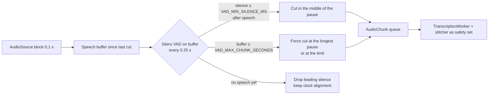
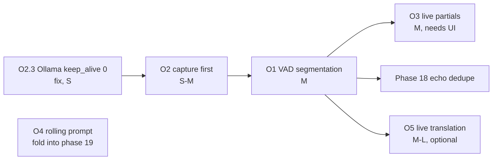

# Optimizations — lessons from `streaming-translator`

Review of [OzerVfonseca/streaming-translator](https://github.com/OzerVfonseca/streaming-translator)
(commit `a94fd61`, 2026-02-24) and what VozAta should adopt, adapt or avoid. Written 2026-10-16,
after phases 00–07. The proposals are scheduled as phases (see [§4](#4-schedule)); this document
keeps the reasoning and the design they share.

> **License.** The repository has no license file (GitHub reports none), so its code is
> "all rights reserved". VozAta reuses **ideas and techniques only**; nothing is copied verbatim.
> All the techniques below (VAD endpointing, interim results, prompt conditioning, buffering
> until ready) are common practice and are re-designed here for VozAta's architecture.

## 1. What the project is

A browser-based live translator: the page captures the microphone (Web Audio,
`ScriptProcessorNode`, 16-bit PCM over a WebSocket) → Node.js server → a Python process per session
running OpenAI Whisper `base` (speech-to-text) and Meta NLLB-200 distilled 600M (translation),
with Piper TTS to speak the translation. One speaker, one channel, no files, no minutes.

The interesting part is `streaming-processor.py`:

- audio accumulates in a growing window (capped at 25 s);
- every **3 s of new audio** the whole window is re-transcribed and an `update` (running text) is
  sent — the user sees text while still speaking;
- **2 s of silence** (peak amplitude below 0.01) **commits** the window as a finished sentence,
  translates it and starts a new window;
- the Node server **queues audio until the Python process reports `ready`** (models loaded), so
  nothing said during model loading is lost;
- Whisper runs with `condition_on_previous_text=True` inside the window.

## 2. Comparison

| Topic | streaming-translator | VozAta today | Verdict |
|-------|----------------------|--------------|---------|
| Segmentation | Pause-based commit (2 s silence) + growing window | Fixed `CHUNK_SECONDS` windows + carry-over stitcher (architecture §7) | **Adopt the idea** with a real VAD: O1 |
| Silence detection | Peak amplitude < 0.01 per 4 KB block | RMS threshold to skip silent windows; Silero only inside Whisper (`vad_filter`) | **Improve**: Silero VAD on the stream (already bundled with faster-whisper) |
| Live feedback | Interim text every 3 s, replaced on commit | Only committed segments (every ~5 s per channel) | **Adopt**: O3 |
| Model load | Audio queued until the processor is ready | `start()` blocks ~20–25 s loading Whisper; audio before that is not captured | **Adopt**: O2 |
| Context | `condition_on_previous_text=True` | Off; `hotwords` only | **Adapt** as a bounded rolling prompt: O4 |
| Translation | NLLB-200 per committed sentence | None | **Optional feature**: O5 |
| Text-to-speech | Piper / phonikud | None | Out of scope (meetings are not read aloud) |
| Capture | Browser microphone only | WASAPI microphone + system loopback, aligned WAVs | VozAta is ahead; keep |
| Dedupe of repeated text | String prefix matching | Word timestamps + committed audio is dropped | VozAta is ahead; keep |
| Long speech | Drops the **oldest** audio past 25 s | `MAX_CARRY_SECONDS` forces a commit | VozAta is ahead; never drop audio |
| Engineering | No tests, model reload per request in `backend.py` | Ports, registries, ≥ 80 % coverage | VozAta is ahead |

## 3. Proposals

Each proposal lists the value, the design in VozAta terms, configuration, tests and risks.
Effort: S ≈ one session, M ≈ one phase, L ≈ more than one phase.

### O1 — Pause-based segmentation with Silero VAD (value: high · effort: M)

**Why.** Fixed 5 s windows cut through phrases; the stitcher repairs that by re-transcribing the
carried tail, which costs GPU time and still delays short utterances by up to a full window.
Cutting where people actually pause gives Whisper whole phrases (better accuracy and
punctuation), commits a short sentence as soon as the speaker stops (lower latency), and lets
silent stretches skip the transcriber entirely (less GPU work, fewer hallucinations on silence).

**Design.**

- New `audio/vad_chunker.py` (`VadChunker`) with the same interface as `FixedWindowChunker`
  (`feed`, `flush`, `paused`); a `CHUNKERS` registry in `bootstrap.py` selects `fixed` or `vad`
  (open/closed principle — `RecordingSession` does not change).
- Voice activity: `faster_whisper.vad.get_speech_timestamps` (Silero ONNX model bundled with
  faster-whisper 1.2.1 — **no new dependency**), run on CPU on the bounded buffer
  (≤ `VAD_MAX_CHUNK_SECONDS`), so the cost stays at a few ms per call. A `SpeechDetector` port
  keeps it replaceable and lets unit tests use a fake detector.
- `AudioChunk.start` stays in session time; dropped leading silence advances the start, so
  transcript timestamps and WAV alignment do not change.
- The carry-over stitcher stays: a forced cut at `VAD_MAX_CHUNK_SECONDS` can still split a
  sentence, and the stitcher completes it as today.

**Config keys** (architecture §9): `CHUNK_MODE` (`vad` | `fixed`, default `vad` once validated),
`VAD_THRESHOLD` (0.5), `VAD_MIN_SILENCE_MS` (600 — the reference project's 2 s is too slow for
dialogue), `VAD_MIN_CHUNK_SECONDS` (1.0), `VAD_MAX_CHUNK_SECONDS` (15), `VAD_SPEECH_PAD_MS` (200).
`CHUNK_SECONDS` keeps its meaning for `fixed`.

**Tests.** Fake detector: cut after the configured pause, forced cut at the maximum, leading
silence dropped with correct `start`, pause/resume flushes, very short blips (< min chunk) merged
into the next chunk. Manual: same TTS meeting as phase 05 — compare latency (speech end → line on
screen) and WER against `fixed`.

**Risks.** Continuous speech without pauses degrades to fixed windows (acceptable). Background
music on the loopback can look like speech — `VAD_THRESHOLD` per channel if needed.

### O2 — Capture first, load later; free the LLM's VRAM (value: high · effort: S–M)

**Why.** Observed in the phase 07 manual check: pressing Start blocks ~20–25 s while Whisper
loads, and anything said in that time is lost. The reference project avoids this by queuing
audio until the model is ready.

**Design.**

1. `RecordingSession.start()` opens the session folder, writers and sources **first**, sets status
   `recording` at once, and loads the transcriber on the transcription worker thread; chunks wait
   in the existing queue and are transcribed when the model is ready (the backlog warning is
   suppressed until then). New `status` detail or `model_loading` event so the UI can show
   "Loading speech model… (recording)".
2. Optional `WHISPER_KEEP_LOADED` (`serve` only): keep the model loaded between sessions so the
   next Start is instant; it is still released before minutes (VRAM rule, architecture §6).
3. **Fix found during this review:** the Ollama client does not send `keep_alive`, so Ollama keeps
   `qwen2.5:7b` in VRAM for 5 minutes after the minutes are written. A new recording in that
   window loads Whisper next to the LLM on a 6 GB GPU — exactly what the VRAM rule forbids
   (risk: CUDA out of memory → CPU fallback). Send `"keep_alive": 0` with the minutes requests
   (a one-line change plus a `MockTransport` test; can ship on its own).

**Tests.** Session tests: status `recording` before the transcriber factory returns; chunks
queued during load are all transcribed; a failed model load reports `error` and keeps the WAVs.
Ollama test: request body contains `keep_alive: 0`.

### O3 — Live interim text (value: medium-high · effort: M)

**Why.** Today a line appears only when a segment is committed. The reference project shows
provisional text every few seconds, which makes the app feel live and helps people follow.

**Design.**

- The worker transcribes the **uncommitted** audio of a channel (the stitcher's carry or the VAD
  buffer) when the GPU is idle (queue empty), at most once per `PARTIAL_INTERVAL_SECONDS` (1.5)
  per channel and only if ≥ 1 s of speech is buffered.
- New WebSocket event `partial` `{channel, speaker_id, label, start, text}` — not written to
  files; the next `segment` (or an empty `partial`) replaces it. Contract change in
  [api-contract.md](api-contract.md).
- UI: one grey, italic line per channel under the transcript, replaced in place.
- Never re-transcribe audio that was already committed (the reference project re-transcribes the
  whole window every 3 s — quadratic cost — and diffs strings by prefix).

**Config.** `LIVE_PARTIALS` (true), `PARTIAL_INTERVAL_SECONDS` (1.5).

**Risks.** GPU time: partials are skipped whenever committed work is waiting, so they never delay
the real transcript.

### O4 — Rolling context prompt (value: medium · effort: S; fold into phase 19)

**Why.** Whisper keeps names, spelling and punctuation consistent when it sees the preceding
text. The reference project gets this from `condition_on_previous_text` inside one window;
VozAta transcribes independent chunks with no context.

**Design.** Per channel, pass the last ~200 characters of committed text (plus the vocabulary
terms of phase 19) as `initial_prompt`; keep `condition_on_previous_text=False`. Clear the prompt
when the language locks or after a long silence. Guard against repetition loops: drop the prompt
for the next chunk when the last segment repeats the previous one or `avg_logprob` is very low;
set `hallucination_silence_threshold`.

**Config.** `CONTEXT_PROMPT_CHARS` (200, 0 = off).

**Tests.** Fake transcriber records the prompt: last committed text per channel, truncation on a
word boundary, reset on language lock, dropped after a repeated segment.

### O5 — Live translation (value: medium · effort: M–L; new feature)

**Why.** Useful when the meeting is held in another language: show each segment translated to
`APP_LANGUAGE` as it arrives. The reference project does this with NLLB-200.

**Design.** New `Translator` port + `TRANSLATORS` registry; `TRANSLATE_TO` key (empty = off).
Translation runs on its own thread from a queue of committed segments and never blocks
transcription; results go to a `translation` field of the `segment` event (and
`transcript.translated.jsonl`). Providers:

| Provider | Notes |
|----------|-------|
| NLLB-200 distilled 600M (`transformers`) | Good quality, many languages; **weights are CC-BY-NC 4.0 (non-commercial)** and add `torch`/`transformers` (~2 GB) |
| MarianMT / Opus-MT (`transformers` or CTranslate2) | Permissive licenses, one model per language pair, fast on CPU |
| Ollama (`qwen2.5`) | No new dependency, but competes with the VRAM rule during recording — CPU-only or after the session |

Run translation on **CPU** during recording (VRAM rule). The language-code table from the
reference project (ISO → NLLB codes) is public NLLB documentation and can be rebuilt freely.

### Not adopted

- **Text-to-speech** (Piper): out of VozAta's scope.
- **Browser capture over HTTPS**: VozAta needs system audio (loopback), which browsers cannot
  capture; WASAPI stays.
- **Anti-patterns to avoid**: loading models per request (`backend.py`), Whisper `base` for
  meetings, peak-amplitude silence detection, dropping old audio when a buffer is full,
  re-transcribing the whole window, deduplicating by string prefix, untyped stdout JSON between
  processes.

## 4. Schedule

| Order | Item | Phase | Depends on |
|-------|------|-------|------------|
| 1 | O2.3 `keep_alive` for Ollama | [25 LLM VRAM release](phases/25-llm-vram-release.md) | 04 |
| 2 | O2 capture first / warm model | [26 Capture first](phases/26-capture-first.md) | 06, 07 |
| 3 | O1 VAD segmentation | [27 Pause-based segmentation](phases/27-vad-segmentation.md) (phase 18 now waits for it) | 05 |
| 4 | O4 rolling prompt | part of [19 Custom vocabulary](phases/19-custom-vocabulary.md) | 06, 10 |
| 5 | O3 live partials | [28 Live interim text](phases/28-live-partials.md) | 27, 07 |
| 6 | O5 live translation | [29 Live translation](phases/29-live-translation.md) (optional) | 06, 07 |

Validate O1 and O4 with numbers, not impressions: the backlog item "WER benchmark harness" (record
the phase 05 TTS meeting once, then compare WER and speech-end-to-line latency for `fixed` vs
`vad`, with and without the context prompt).
