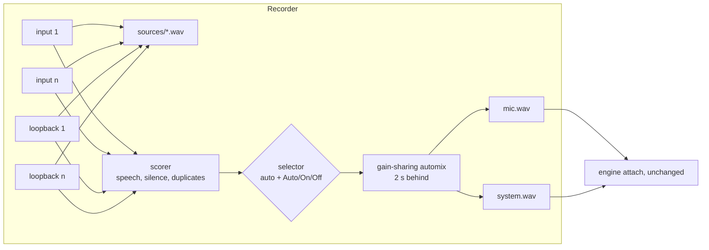

# Phase 65 — Record every audio device, choose the sources automatically

## Goal

A recording never comes out silent because the wrong device was picked. The recorder records
**every microphone and every output (loopback)** at once, each to its own file, and mixes the
**selected** sources into the usual `mic.wav` / `system.wav`, so everything downstream
(live transcript, echo dedupe, speakers, minutes) is unchanged. The selection is **automatic**
(sources with speech, silent and duplicate sources left out) and can be **changed by hand during
the recording** (Auto / On / Off per source). Several microphones in other rooms all come through.

Requested by the user on 2026-11-12, after a meeting recorded on a silent loopback (the call
played on the JBL headset; the Realtek loopback and the mic gave only zeros).

## Depends on

61, 63

## Read first

- `engine/CLAUDE.md`, `ui/CLAUDE.md`, [phase 61](61-recorder-process.md)
- `recorder/recording.py`, `recorder/durable_track.py`, `recorder/manifest.py`, `recorder/app.py`,
  `audio/devices.py`, `audio/capture.py`; `RecorderPageViewModel.cs`, `RecorderPage.axaml`,
  `VozAta.Client/Recorder.cs`

## Design

- A **source** is a capture device with a stable id (`in-<slug>` / `out-<slug>` of its name, not
  the PortAudio index). An input feeds the `mic` channel, a loopback the `system` channel.
- Each source is written by its own `DurableTrack` to `live/<id>/sources/<source_id>.wav`
  (segments in the manifest's `sources`), so nothing is lost whatever the selection.
- The **mixer** runs 2 s behind the capture: the scorer looks at the newest audio first, so a
  source that starts speaking is selected *before* its first words are mixed.
- **Score** over a 10 s window of 20 ms frames: active frames (above -50 dBFS and 12 dB over the
  window's noise floor); a window of exact zeros is **digital silence**. Auto selects a source
  after 0.5 s of activity and drops it after 60 s without any. Two sources of the same kind whose
  level envelopes correlate above 0.9 are **duplicates** (two mics in one room, "Stereo Mix"):
  only the best stays. A kind with nothing selected keeps its previous selection (at start: the
  preferred device: the UI's choice or the Windows default).
- **Gain-sharing automix** (Dugan): per 20 ms, each selected source gets the share of the power
  it has; one source passes unchanged, quiet rooms don't add their noise.
- The preferred devices open first (the recording starts at once); the others open in the
  background, and a source that fails or hangs is skipped and reported, never ending the
  recording. Start fails only when no source opens.
- `CAPTURE_SOURCES=pair` keeps the old behavior (two devices, no mixing).

## Scope

**Engine**

| File | Content |
|------|---------|
| `recorder/sources.py` | `SourceSpec`, source ids, `resolve_sources` (every input + loopback, exclusions, preferred) |
| `recorder/source_mix.py` | `SourceBuffer`, `automix`, `SourceScorer`, `SourceSelector`, `SourceMixer` (pure numpy) |
| `recorder/recording.py` | raw tracks + the mix thread when sources are given; `set_source_mode`; `on_sources` |
| `recorder/manifest.py` | `sources` (kind, name, mode, selected, preferred, failed, segments), `selection_log` |
| `recorder/durable_track.py` | a track named by a string (a source id or a channel) |
| `recorder/settings.py` | `CAPTURE_SOURCES`, `CAPTURE_EXCLUDE` |
| `recorder/app.py` | `GET /recordings/current/sources`, `PUT /recordings/current/sources/{source_id}`, `sources` SSE event |

**UI**

| File | Content |
|------|---------|
| `VozAta.Client/Recorder.cs`, `Dtos.cs` | `RecordingSource`, `SourcesEvent`, `SetSourceModeAsync` |
| `SourceRowViewModel.cs`, `RecorderPageViewModel.cs`, `RecorderPage.axaml` | the source list: name, kind, meter, selected badge, Auto / On / Off |
| Resources | strings in en / pt-BR / es |

## Acceptance criteria

- [ ] With `CAPTURE_SOURCES=all` (default) every input and loopback is recorded to its own file.
- [ ] A source with speech is selected automatically and its audio reaches `mic.wav` /
      `system.wav`; a silent (zeros) source is not selected; of two duplicated sources one stays.
- [ ] Auto / On / Off per source during the recording, saved in the manifest's `selection_log`.
- [ ] A source that fails to open is skipped and reported; the recording goes on.
- [ ] `CAPTURE_SOURCES=pair` records exactly as before.
- [ ] Recorder restart continues every source (gap as before).
- [ ] The UI lists the sources with level, selection and the mode toggle.
- [ ] en / pt-BR / es parity; coverage ≥ 80 %.

## Tests

`tests/recorder/test_sources.py`, `tests/recorder/test_source_mix.py`,
`tests/recorder/test_recording_sources.py`, `tests/recorder/test_app.py`,
`RecorderPageViewModelTests.cs`, `SourceRowViewModelTests.cs`.

## Out of scope

Keeping the sources after the meeting and changing the selection afterwards (phase 66);
devices plugged in during a recording.

## Kickoff prompt

> Execute phase 65 of the roadmap (`docs/roadmap/phases/65-all-sources.md`), following
> `docs/roadmap/README.md`.

## Progress

- **Branch:** `feature/65-all-sources`
- **Status:** in progress
- **Updated:** 2026-11-12
- **Next step:** engine: `recorder/source_capture.py` + `Recording` with every source (raw tracks under `sources/`, the mix thread, resume, manifest `sources` / `selection_log`).

### Steps

- [x] Start the phase (README status, Progress; phase files 66 and 67 written)
- [x] Engine: sources and their ids, `CAPTURE_SOURCES` / `CAPTURE_EXCLUDE`
- [x] Engine: `source_mix.py` (buffer, automix, scorer, selector, mixer)
- [ ] Engine: `Recording` with every source (raw tracks, mix thread, resume, manifest)
- [ ] Engine: recorder API (`sources` routes and event)
- [ ] UI: the source list
- [ ] Docs (architecture, api-contract, config keys), full suites
- [ ] PR

### Decisions and notes

- Diagnosis of 2026-11-12: `live/20261112_140724` has only zeros on both channels (mic
  "JBL Quantum Stream", loopback "Realtek"); the Windows default output is the JBL headset.
- Cross-kind duplicates (a mic that hears the speakers) are left to the echo dedupe of phase 18:
  dropping such a mic would also lose the user's own words.
- `mic` / `system` stay the logical channels: the recorder mixes the selected sources into them,
  so the engine, the database and the minutes need no change in this phase.
