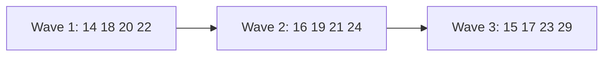
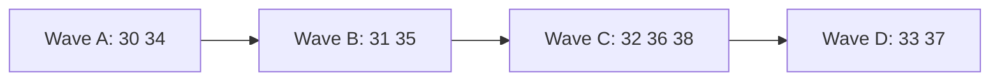

# VozAta — Parallel waves

Phases of [README.md](README.md) grouped into waves (M4 waves 1–3 are done; M6 waves A–D are
next). Phases in the same wave run
at the same time, each in its own session or agent and on its own `feature/<NN-slug>` branch. A
wave starts once every PR of the previous wave is merged into `main`.

The waves are chosen to keep phases that edit the same hotspot apart:

- `session.py` stop sequence: 14, 17, 22, 23.
- Transcription path (`worker.py`, `session_pipeline.py`): 15, 18, 19, 29.
- Session detail (`HistoryView` / `SessionDetailViewModel`): 20, 21, 22, 23.
- Start screen (`MainWindow` / `MainViewModel`): 17, 19, 20, 29.

| Wave | Phases | Notes |
|------|--------|-------|
| 1 | 14, 18, 20, 22 | 14 and 18 are engine only; 20 and 22 share only a little of the session detail |
| 2 | 16, 19, 21, 24 | need 14 (16) and 22 (21, 24); 19 is the only one in the transcription path |
| 3 | 15, 17, 23, 29 | 17 comes after the stop steps have settled; 15 and 29 use separate workers |

## Rules for parallel phases

1. Follow [README.md](README.md) *How to run a session* and the project `CLAUDE.md`.
2. **Resume first**:
   - Run `git fetch`.
   - If `feature/<NN-slug>` exists (local, remote or as an open PR), check it out, run
     `git status`, and continue from the phase file's Progress *Next step*.
   - Otherwise, branch from an up-to-date `main`.
3. Touch only what the phase needs. Expect **additive** conflicts with the other phases of the
   wave, in:
   - `config.py`, `settings_fields.py` (`FIELDS`) and `engine/.env.example`;
   - `Strings*.resx`, `Dtos.cs`, `EngineClient.cs` and `FakeEngineClient.cs`;
   - the README status table.

   Resolve them by merging `origin/main` into the branch. Never rebase or force-push.
4. Work with TDD and keep one concern per commit. Every commit updates Progress and is pushed.
5. Do not run microphone, speaker or GPU checks inside a parallel session. The audio hardware is
   shared, so these run one phase at a time before merge. Write an exact **manual check recipe**
   in Progress instead.
6. A check that needs credentials you don't have (HF token, Azure DevOps PAT, GitHub token) is
   marked `pending manual (credentials)` in Progress. The phase is still finished on fakes.
7. When done:
   - Tick the acceptance criteria and set the README status to `done`.
   - Run the full engine and UI test suites locally (PR CI only lints and compiles), then open
     the PR and wait for the checks. Fix failures from the logs, at most 5 cycles.
   - Report the PR number and the manual check recipe.

## Prompts

Paste a prompt into a fresh session, either to start the phase or to resume it.

### Wave 1

**14 — Speaker identification (post-session)**
> Execute (or resume) phase 14 of the roadmap (`docs/roadmap/phases/14-diarization-post.md`),
> following `docs/roadmap/README.md` and the rules in `docs/roadmap/waves.md`. It runs in parallel
> with phases 18, 20 and 22.
> - pyannote sits behind the `Diarizer` port, as the optional extra `diarization`.
> - If torch and ctranslate2 clash over CUDA, run the diarizer in a subprocess.
> - Without HF_TOKEN, mark the real check `pending manual (credentials)`.

**18 — Echo dedupe**
> Execute (or resume) phase 18 of the roadmap (`docs/roadmap/phases/18-echo-dedupe.md`), following
> `docs/roadmap/README.md` and the rules in `docs/roadmap/waves.md`. It runs in parallel with
> phases 14, 20 and 22.
> - Engine only.
> - The filter goes in front of the sinks.
> - Document the new counter `session.json.echo_dropped` in architecture §8.

**20 — Minutes templates**
> Execute (or resume) phase 20 of the roadmap (`docs/roadmap/phases/20-minutes-templates.md`),
> following `docs/roadmap/README.md` and the rules in `docs/roadmap/waves.md`. It runs in parallel
> with phases 14, 18 and 22.
> - Templates are package data (`pyproject.toml`), in en, pt-BR and es.
> - Keep the session detail changes to the regenerate action.

**22 — Cross-session search**
> Execute (or resume) phase 22 of the roadmap (`docs/roadmap/phases/22-search.md`), following
> `docs/roadmap/README.md` and the rules in `docs/roadmap/waves.md`. It runs in parallel with
> phases 14, 18 and 20.
> - Use stdlib sqlite3 FTS5; check that it is available.
> - Indexing is a stop step in `session.py`.
> - Expose `SearchIndex` so phases 21 and 24 can reuse it.

### Wave 2

**16 — UI speaker rename**
> Execute (or resume) phase 16 of the roadmap (`docs/roadmap/phases/16-ui-speaker-rename.md`),
> following `docs/roadmap/README.md` and the rules in `docs/roadmap/waves.md`. It runs in parallel
> with phases 19, 21 and 24.
> - Use the `speakers.json` written by phase 14.
> - The rename UI lives in the session detail.

**19 — Custom vocabulary**
> Execute (or resume) phase 19 of the roadmap (`docs/roadmap/phases/19-custom-vocabulary.md`),
> following `docs/roadmap/README.md` and the rules in `docs/roadmap/waves.md`. It runs in parallel
> with phases 16, 21 and 24.
> - It is the only phase of the wave that touches `worker.py` and `faster_whisper.py`.
> - Add the glossary to the minutes prompt without breaking phase 20's templates.

**21 — Editable transcript**
> Execute (or resume) phase 21 of the roadmap (`docs/roadmap/phases/21-editable-transcript.md`),
> following `docs/roadmap/README.md` and the rules in `docs/roadmap/waves.md`. It runs in parallel
> with phases 16, 19 and 24.
> - After saving edits, call `SearchIndex.index_session` (phase 22).
> - Document the `edited` field in api-contract and architecture §8.

**24 — Ask the meeting**
> Execute (or resume) phase 24 of the roadmap (`docs/roadmap/phases/24-ask-the-meeting.md`),
> following `docs/roadmap/README.md` and the rules in `docs/roadmap/waves.md`. It runs in parallel
> with phases 16, 19 and 21.
> - Retrieval reuses phase 22's `SearchIndex`.
> - The LLM goes through the `LanguageModel` port, with a fake in tests.

### Wave 3

**15 — Speaker identification (live)**
> Execute (or resume) phase 15 of the roadmap (`docs/roadmap/phases/15-diarization-live.md`),
> following `docs/roadmap/README.md` and the rules in `docs/roadmap/waves.md`. It runs in parallel
> with phases 17, 23 and 29.
> - Live diarization runs in its own worker and never blocks the transcription path.
> - Without HF_TOKEN, mark the real check `pending manual (credentials)`.

**17 — Crash recovery**
> Execute (or resume) phase 17 of the roadmap (`docs/roadmap/phases/17-crash-recovery.md`),
> following `docs/roadmap/README.md` and the rules in `docs/roadmap/waves.md`. It runs in parallel
> with phases 15, 23 and 29.
> - `recover()` reuses the session's own stop-step list, so it includes diarization (14),
>   indexing (22) and action items (23) without duplicating them.

**23 — Action items export**
> Execute (or resume) phase 23 of the roadmap (`docs/roadmap/phases/23-action-items.md`),
> following `docs/roadmap/README.md` and the rules in `docs/roadmap/waves.md`. It runs in parallel
> with phases 15, 17 and 29.
> - The Azure DevOps and GitHub exporters are registered in `TASK_EXPORTERS`.
> - Tests use fakes or mocked HTTP.
> - The real export is `pending manual (credentials)` without tokens.

**29 — Live translation**
> Execute (or resume) phase 29 of the roadmap (`docs/roadmap/phases/29-live-translation.md`),
> following `docs/roadmap/README.md` and the rules in `docs/roadmap/waves.md`. It runs in parallel
> with phases 15, 17 and 23.
> - The CPU translator runs in its own worker.
> - Record the provider choice in architecture.
> - If the model download is impractical, the real check stays pending.

## M6 — Storage and UI refresh (waves A–D)

Hotspots in M6:

- Storage (`storage/`, `ports.py`, `bootstrap.py`, `session.py`): 30, 31, 32, 33 — kept in
  consecutive waves, never two at once.
- Shell and pages (`MainWindow`, `MainViewModel`, page views): 35 first, then 36, 37 and 38 each
  own their page.
- Shared additive files: `api-contract.md`, `Dtos.cs`, `EngineClient.cs`, `FakeEngineClient.cs`,
  `Strings*.resx`, `settings_fields.py`, `.env.example`.

| Wave | Phases | Notes |
|------|--------|-------|
| A | 30, 34 | engine storage refactor and UI styles only — no shared files |
| B | 31, 35 | 31 is engine storage; 35 is the UI shell plus the small `title` contract, which goes through the phase 30 port so it works on both backends |
| C | 32, 36, 38 | audio storage, Meetings page, Config page — separate pages; additive conflicts only |
| D | 33, 37 | migration (engine) and the detail page with the player (UI) |

Extra rules for M6 (on top of the rules above):

- Each agent uses its own scratch subfolder (`scratchpad/phaseNN/`), never a shared one.
- In a git worktree, run tests with `PYTHONPATH=<worktree>/engine/src` (the `.venv` editable
  install points at the main checkout).
- Crash and recovery checks (31, 32, 33) hard-kill a recording engine, which can wedge WASAPI on
  the reference machine: run them last and ask the user to restart Windows Audio afterwards.
- UI phases attach light and dark screenshots to the PR.

### Wave A

**30 — Storage port**
> Execute (or resume) phase 30 of the roadmap (`docs/roadmap/phases/30-storage-port.md`),
> following `docs/roadmap/README.md` and the rules in `docs/roadmap/waves.md`. It runs in parallel
> with phase 34.
> - Pure refactor: no behavior or API change; every existing test keeps passing.
> - Write the shared repository contract suite that phase 31 will reuse.

**34 — UI design system**
> Execute (or resume) phase 34 of the roadmap (`docs/roadmap/phases/34-ui-design-system.md`),
> following `docs/roadmap/README.md` and the rules in `docs/roadmap/waves.md`. It runs in parallel
> with phase 30.
> - Look only: tokens, icons and styles; no layout change.
> - Check contrast in light and dark; screenshots in the PR.

### Wave B

**31 — SQLite session database**
> Execute (or resume) phase 31 of the roadmap (`docs/roadmap/phases/31-sqlite-database.md`),
> following `docs/roadmap/README.md` and the rules in `docs/roadmap/waves.md`. It runs in parallel
> with phase 35.
> - Implement the phase 30 ports; reuse the contract suite.
> - Audio stays in WAV files in this phase.
> - Warn when the database is in a OneDrive folder.

**35 — Toggl-style shell and timer bar**
> Execute (or resume) phase 35 of the roadmap (`docs/roadmap/phases/35-toggl-shell.md`),
> following `docs/roadmap/README.md` and the rules in `docs/roadmap/waves.md`. It runs in parallel
> with phase 31.
> - Split `MainViewModel` into page ViewModels; keep `MainWindow` as the window class.
> - The `title` contract goes through the phase 30 repository port (both backends).

### Wave C

**32 — Audio in SQLite**
> Execute (or resume) phase 32 of the roadmap (`docs/roadmap/phases/32-audio-in-sqlite.md`),
> following `docs/roadmap/README.md` and the rules in `docs/roadmap/waves.md`. It runs in parallel
> with phases 36 and 38.
> - The capture callback never waits on SQLite.
> - Run the hard-kill recovery check last, then ask for a Windows Audio restart.

**36 — Meetings list grouped by day**
> Execute (or resume) phase 36 of the roadmap (`docs/roadmap/phases/36-meetings-by-day.md`),
> following `docs/roadmap/README.md` and the rules in `docs/roadmap/waves.md`. It runs in parallel
> with phases 32 and 38.
> - Only the Meetings page; the detail stays as it is until phase 37.
> - File-backend delete goes to the Recycle Bin, never permanent.

**38 — Config page redesign**
> Execute (or resume) phase 38 of the roadmap (`docs/roadmap/phases/38-config-page.md`),
> following `docs/roadmap/README.md` and the rules in `docs/roadmap/waves.md`. It runs in parallel
> with phases 32 and 36.
> - `.env` stays the source; editors stay generated from `GET /settings`.
> - Test buttons use mocked HTTP in unit tests; real checks need the user's tokens.

### Wave D

**33 — Folder to database migration**
> Execute (or resume) phase 33 of the roadmap (`docs/roadmap/phases/33-folder-migration.md`),
> following `docs/roadmap/README.md` and the rules in `docs/roadmap/waves.md`. It runs in parallel
> with phase 37.
> - Never delete or modify the legacy folders (except phase 17 repair of interrupted ones).
> - Manual check on a scratch copy of `engine/recordings`, comparing hashes afterwards.

**37 — Session detail page and audio player**
> Execute (or resume) phase 37 of the roadmap (`docs/roadmap/phases/37-detail-and-player.md`),
> following `docs/roadmap/README.md` and the rules in `docs/roadmap/waves.md`. It runs in parallel
> with phase 33.
> - Player behind an `IAudioPlayer` port; LibVLCSharp unless the installer size rules it out
>   (record the decision).
